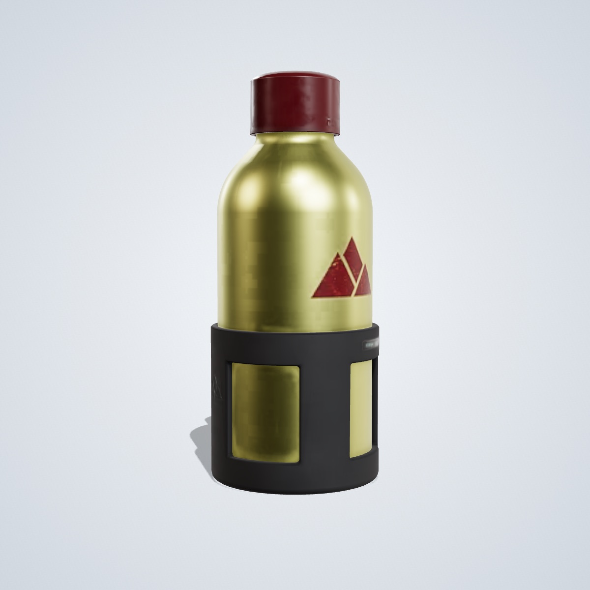
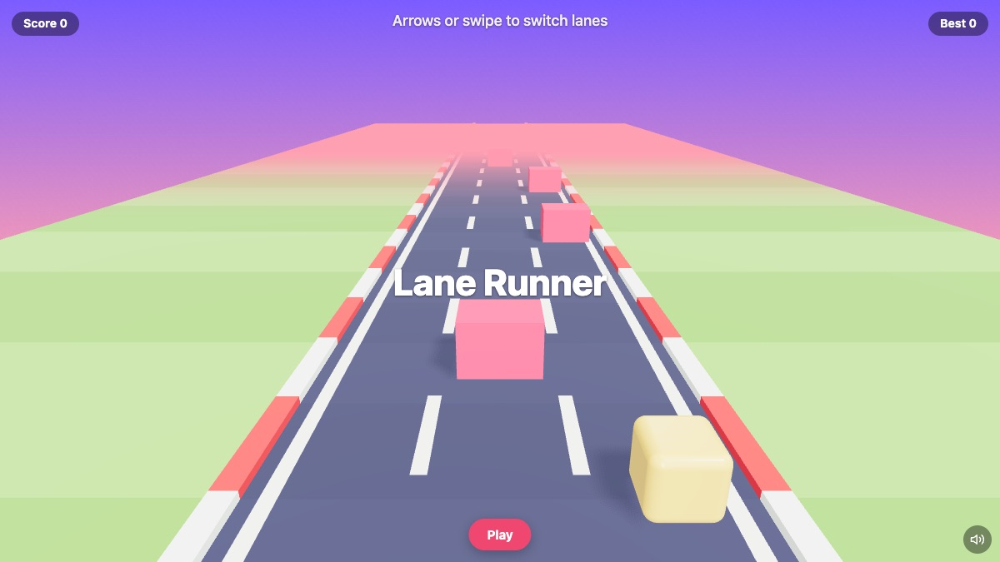

# Agent3D

**The 3D studio your AI agent can run.** Ask for "an animated banner for my bakery", "a low-poly island hero" or "a mini game where you dodge blocks": your agent writes the scene as JSON, renders it headless with your own Chrome, **looks at the screenshots**, fixes what it sees, and exports a self-contained embed for any website.

No server, no account, no CDN. The output is a Web Component and a few static files (or one HTML file) that you drop on any site.

| | | |
|---|---|---|
|  |  |  |
| Banner (4:1) | Hero with room for your headline (16:9) | Landscape (21:9) |
|  |  |  |
| Character card (1:1) | Product turntable (1:1) | Mini game (16:9) |

<sub>Headless renders of the scenes in the [recipes](plugin/skills/agent3d-create/references/recipes.md), straight from `agent3d render`.</sub>

## How it works

1. **A scene is JSON** (`scene.json`): target and aspect ratio, camera, environment, lights, objects (primitives, 3D text, glTF models, SVG logos, procedural generators, particles), materials and shaders, behaviours, a keyframe timeline, post effects — and, for games, physics, a HUD and sandboxed scripts. Everything is validated against a [catalog](docs/catalog.md) with "did you mean" hints.
2. **The agent previews it headless**: deterministic frames and a contact sheet it can look at, plus stats (triangles, draw calls) and per-object framing data.

   

3. **`check`** catches what a human reviewer would: validation, missing files, the script sandbox, triangle and size budgets per target, framing, accessibility settings, licences that need credit.
4. **`export`** writes the embed: the runtime (shared by every scene of the site), the scene, its assets, a poster, a demo page and the snippet.

```html
<script type="module" src="/agent3d/agent3d-runtime/agent3d-runtime.js"></script>
<agent3d-scene src="/agent3d/bakery/scene.json" poster="/agent3d/bakery/poster.webp" aria-label="Golden Crust Bakery: a warm 3D title with floating pastries"></agent3d-scene>
```

The element starts when it scrolls into view, pauses off-screen, caps the pixel ratio, freezes on the poster frame for visitors who prefer reduced motion, shows the poster without WebGL, and never calls a third-party server.

## 30-second demo

```bash
npx -y @fleox/agent3d@0.1.0 new bakery --target banner --title "Golden Crust" --json
npx -y @fleox/agent3d@0.1.0 scene patch --project bakery --json '[{"op":"set","path":"objects#title.material","value":{"preset":"gold"}}]'
npx -y @fleox/agent3d@0.1.0 render --project bakery --sheet --json     # → renders/…-sheet.png
npx -y @fleox/agent3d@0.1.0 check --project bakery --json
npx -y @fleox/agent3d@0.1.0 export --project bakery --json             # → dist/embed/ + the snippet
```

Requirements: **Node.js 22+** and **Google Chrome** (or Chromium / Edge) for previews. `npx -y @fleox/agent3d@0.1.0 doctor` checks your setup. Step by step: [docs/getting-started.md](docs/getting-started.md).

## Use it from your agent

**Claude Code** — install the skills from this repository's plugin marketplace:

```text
/plugin marketplace add fleox/agent3d
/plugin install agent3d@agent3d
```

| Skill | Use it to |
|---|---|
| `agent3d-create` | Go from a brief to a finished embed: clarify, pick a template, build, render and look, fix, check, export — with art direction (composition, lighting recipes, palettes, motion, budgets) and validated recipes per kind |
| `agent3d-edit` | Change an existing scene: patches, materials, lights, camera, timeline, behaviours, rebranding, phone checks |
| `agent3d-assets` | Built-in CC0 library, procedural generators, Poly Haven / ambientCG / Khronos downloads, Kenney / Quaternius packs, licences |
| `agent3d-game` | Mini games and interactive logic with the sandboxed ScriptApi (input, physics, spawning, HUD, sounds, best score, attract mode) |
| `agent3d-publish` | Export formats, plain HTML, WordPress, AgentCMS, React / Next.js / Astro / Vue, performance, accessibility and CSP |

**MCP** (Claude Desktop, Claude Code, Cursor, Hermes, any client) — the tools of the engine plus `render_preview`, which returns the contact sheet as an **image** so multimodal models see their work:

```bash
claude mcp add agent3d -- npx -y @fleox/agent3d@0.1.0 mcp --project ~/agent3d/my-banner
```

Configuration for every client: [docs/mcp.md](docs/mcp.md).

**Hermes Agent** — the same skills with a stdlib-only Python wrapper and helpers: [hermes/](hermes/).

## The Studio

A visual editor for when you want to see and touch the scene yourself — viewport, outliner, inspector, timeline, catalog and library browser, templates, checks, render and export dialogs, and an optional assistant using your own Claude API key. Changes your agent makes in a terminal show up live.

```bash
npx -y @fleox/agent3d@0.1.0 studio --project bakery
```

Details: [docs/studio.md](docs/studio.md). Live preview without the editor: `agent3d serve --project bakery --open`.

## What you get in an export

```
dist/embed/
  agent3d-runtime/        the player (ES module + lazy chunks), shared by every scene of the site
  bakery/                 scene.json, assets/, scripts/, poster.webp, CREDITS.txt
  index.html              a demo page with the snippet and the credits
  snippet.html            what to paste into your page
```

Also: `--format single-html` (one file with everything inline), `--format poster` (a still) and `--format video` (WebM). Putting it on WordPress, AgentCMS ([plugin](integrations/agentcms/)), React, Next.js, Astro or Vue: [docs/export.md](docs/export.md) and the `agent3d-publish` skill.

## Documentation

[docs/](docs/README.md): [scene format](docs/scene-format.md) · [catalog](docs/catalog.md) · [CLI](docs/cli.md) · [MCP](docs/mcp.md) · [scripting](docs/scripting.md) · [export](docs/export.md) · [assets](docs/assets.md) · [Studio](docs/studio.md) · [architecture](docs/architecture.md) · [security](docs/security.md) · [releasing](docs/releasing.md). Contributors and agents working on this repository: [AGENTS.md](AGENTS.md) and [CLAUDE.md](CLAUDE.md).

## Licence

[PolyForm Noncommercial 1.0.0](LICENSE) — free for personal, research, educational and other noncommercial use. Contact the author for commercial use.

## Credits

- [three.js](https://threejs.org) (MIT) renders everything.
- The built-in library is CC0 (KayKit by Kay Lousberg, Kenney, Poly Haven textures and HDRIs, Khronos glTF samples, RobotExpressive by Tomás Laulhé / Quaternius), with the fonts under Apache-2.0 / OFL-1.1 and CC BY parts on the Khronos fox: full list and attribution lines in [library/LICENSES.md](library/LICENSES.md). Exports list the credits their assets need.
- Assets you download with `agent3d assets` keep their licence in your project (`assets/manifest.json`).
