<p align="center">
  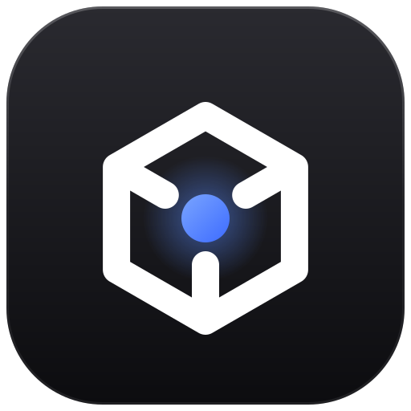
</p>

<h1 align="center">Agent3D</h1>

<p align="center">
  <strong>The 3D studio your AI agent can run.</strong><br>
  Banners, heroes, product shots, characters, landscapes and mini games for any website.<br>
  Everything runs locally: no server, no account, nothing that phones home.
</p>

<p align="center">
  <a href="https://www.npmjs.com/package/@fleox/agent3d"></a>
  <a href="https://github.com/fleox/agent3d/actions/workflows/ci.yml"></a>
  <a href="https://www.npmjs.com/package/@fleox/agent3d"></a>
  <a href="#claude-code"></a>
  <a href="#mcp-server"></a>
  <a href="https://m8ven.ai/mcp/fleox/agent3d?s=readme"></a>
  <a href="https://github.com/fleox/agent3d/blob/main/LICENSE"></a>
</p>

<p align="center">
  <a href="#quick-start">Quick start</a> ·
  <a href="#features">Features</a> ·
  <a href="#the-studio">Studio</a> ·
  <a href="#templates">Templates</a> ·
  <a href="#how-it-works">How it works</a> ·
  <a href="#the-agent3d-cli">CLI</a> ·
  <a href="#mcp-server">MCP</a> ·
  <a href="https://github.com/fleox/agent3d/blob/main/docs/README.md">Docs</a> ·
  <a href="https://github.com/fleox/agent3d/blob/main/changelog.json">Changelog</a>
</p>

<p align="center">
  <a href="https://cdn.jsdelivr.net/gh/fleox/agent3d@main/.github/assets/agent3d-demo.mp4">
    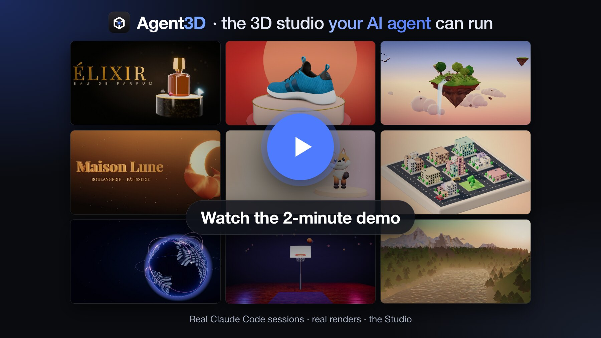
  </a>
  <br><sub>▶️ <a href="https://cdn.jsdelivr.net/gh/fleox/agent3d@main/.github/assets/agent3d-demo.mp4">Watch the demo</a> (2 min 11 s): real Claude Code sessions build a 3D hero banner from one sentence, edit it and make a mini game (the agent's work sped up, labelled on screen), then live templates, the Studio and the export.</sub>
</p>

---

## Why Agent3D

<table>
<tr>
<td width="33%" valign="top">
<h3>🎬 Stunning by default</h3>
<p>One-line light rigs, physical skies, contact shadows, physically based materials (car paint, ceramic, glass, diamond…) and cinematic <b>looks</b> (bloom, ambient occlusion, depth of field, grading). Agents start from 34 templates and validated recipes, with art direction built into the skills.</p>
</td>
<td width="33%" valign="top">
<h3>🤖 Agent-native</h3>
<p>A scene is one JSON file, validated against a catalog with "did you mean" hints and edited with small atomic patches. The agent <b>renders it headless</b> with your own Chrome, <b>looks at the screenshots</b>, fixes what it sees and runs <code>check</code> on budgets and accessibility. Every action is a CLI command with JSON output, an MCP tool and a Studio action.</p>
</td>
<td width="33%" valign="top">
<h3>🌐 Made for the web, nothing to run</h3>
<p>The output is a Web Component and a few static files (or one HTML file) for any site: lazy start, pause off-screen, reduced motion, a poster without WebGL, no layout shift. No Agent3D server, account or subscription; no CDN, web fonts or analytics in the exports.</p>
</td>
</tr>
</table>

## Quick start

### With an AI agent

<a id="claude-code"></a>**Claude Code**

```text
/plugin marketplace add fleox/agent3d
/plugin install agent3d@agent3d
```

Then just ask:

> *Create an animated 3D hero banner for my bakery "Maison Lune": warm colours, a croissant, the title, subtle motion. Render it so I can see it, then export it for my website.*<br>
> *Make it more premium: golden-hour lighting, gold letters revealed one by one, and a click on the croissant that opens /shop.*<br>
> *Make a small 3D mini game for my sports brand site: an endless runner in black and neon yellow, playable on mobile.*

The agent picks a template or a starter, writes the scene, renders it, looks at the frames, fixes framing, colours and motion, checks budgets and exports the embed with the snippet to paste.

<p align="center">
  
  <br><sub>A real, unedited Claude Code session. The agent's work (about 5 minutes) is sped up ×32 (labelled); typing and the answer play in real time. It ends on the agent's own final render.</sub>
</p>

Once the scene exists, changing it is a conversation:

<p align="center">
  
  <br><sub>Same project, a second request: lighting, a letter reveal and a click interaction, then a new render the agent looks at and a re-export. Sped up ×16 while the agent works (labelled).</sub>
</p>

<details>
<summary><b>And a third one: <i>"Make a small 3D mini game…"</i></b></summary>
<p align="center">
  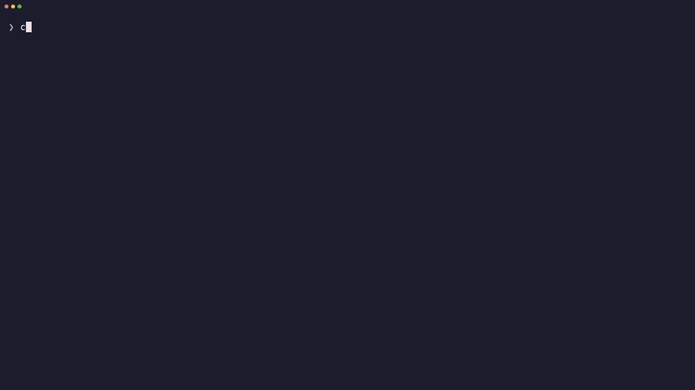
  <br><sub>A playable game from one request: sandboxed script, HUD, touch controls, play-tested headlessly with simulated input. Sped up ×16 while the agent works (labelled).</sub>
</p>
</details>

| Agent | Setup |
|---|---|
| **Claude Code** | the plugin above: skills `agent3d-create`, `agent3d-edit`, `agent3d-assets`, `agent3d-game`, `agent3d-publish` |
| **Claude Desktop, Cursor, any MCP client** | the [MCP server](#mcp-server): `agent3d mcp --project <dir>` |
| **Hermes Agent** / Python agents | generated skills with a Python wrapper, see [hermes/](https://github.com/fleox/agent3d/tree/main/hermes) |
| **Codex, Windsurf, any other agent** | point it at [AGENTS.md](https://github.com/fleox/agent3d/blob/main/AGENTS.md) and the Markdown skills in [plugin/skills/](https://github.com/fleox/agent3d/tree/main/plugin/skills) |

### Without an agent

```bash
npx -y @fleox/agent3d@0.5.1 new bakery --target banner --title "Golden Crust"
npx -y @fleox/agent3d@0.5.1 studio --project bakery
```

The first command creates a project folder with an attractive starter scene for its target (banner, hero, card, square, fullscreen, inline or game); add `--template <id>` to start from one of the [templates](#templates). The second opens the [Studio](#the-studio) on it. You need **Node.js 22+** and **Google Chrome** (or Chromium / Edge / Brave) for renders; `npx -y @fleox/agent3d@0.5.1 doctor` checks your setup with a test render.

The whole loop from a terminal:

```bash
npx -y @fleox/agent3d@0.5.1 scene patch --project bakery '[{"op":"set","path":"objects#title.material","value":{"preset":"gold"}}]'
npx -y @fleox/agent3d@0.5.1 render --project bakery --sheet     # → renders/…-sheet.png
npx -y @fleox/agent3d@0.5.1 check --project bakery
npx -y @fleox/agent3d@0.5.1 export --project bakery             # → dist/embed/ + the snippet
```

Step by step: [docs/getting-started.md](https://github.com/fleox/agent3d/blob/main/docs/getting-started.md).

## Features

<table>
<tr>
<td width="50%">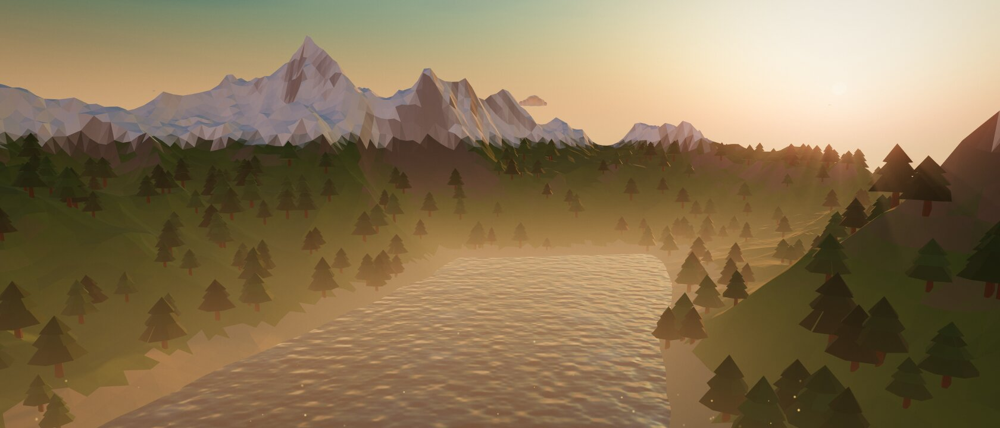<p align="center"><b>Mountain valley at sunset</b>: physical sky, mirror lake, height fog</p></td>
<td width="50%"><p align="center"><b>Luxury perfume hero</b>: refractive glass, gems, rack focus</p></td>
</tr>
<tr>
<td width="50%">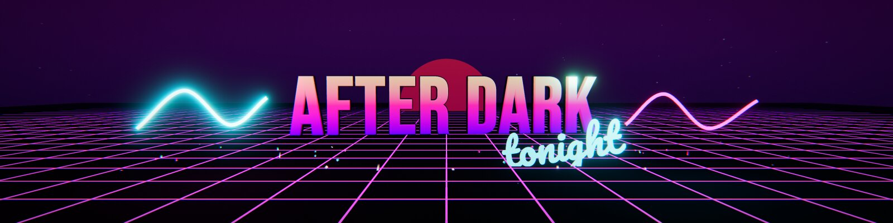<p align="center"><b>Neon title banner</b>: kerned 3D type, letter reveal, bloom</p></td>
<td width="50%">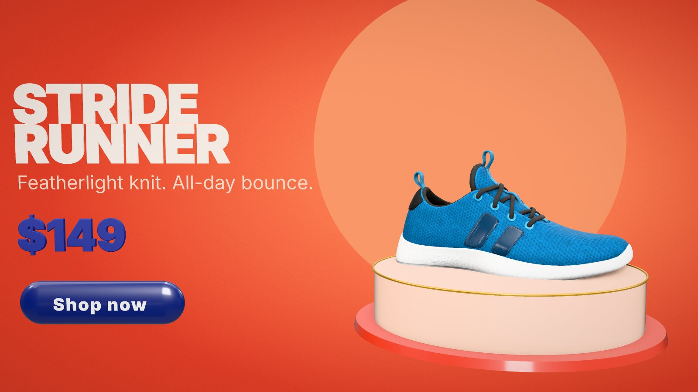<p align="center"><b>Sneaker showcase</b>: product lighting, data-bound price, click to a detail view</p></td>
</tr>
<tr>
<td width="50%">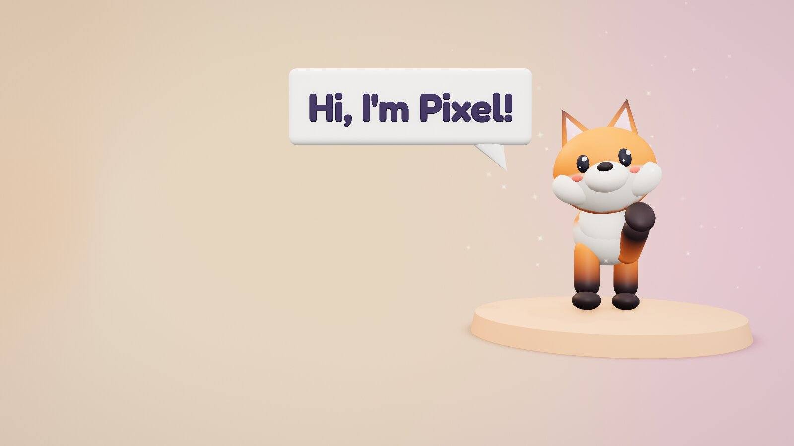<p align="center"><b>Mascot hero</b>: procedural character, eyes follow the pointer</p></td>
<td width="50%">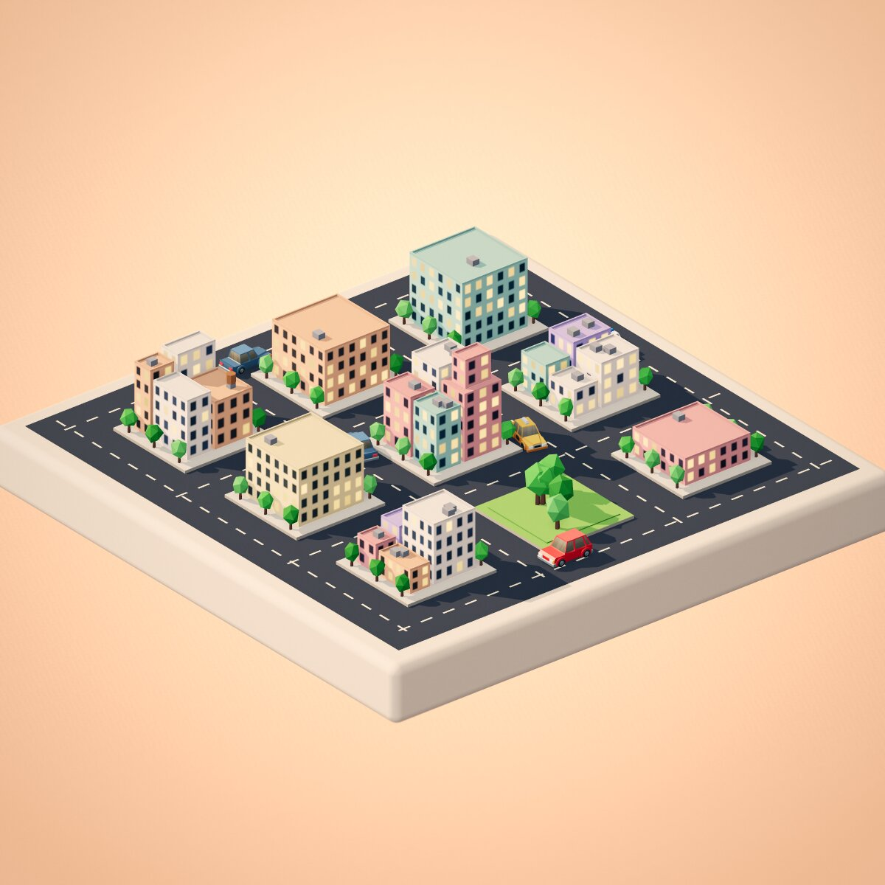<p align="center"><b>Isometric city diorama</b>: generators, tilt-shift, long shadows</p></td>
</tr>
<tr>
<td width="50%">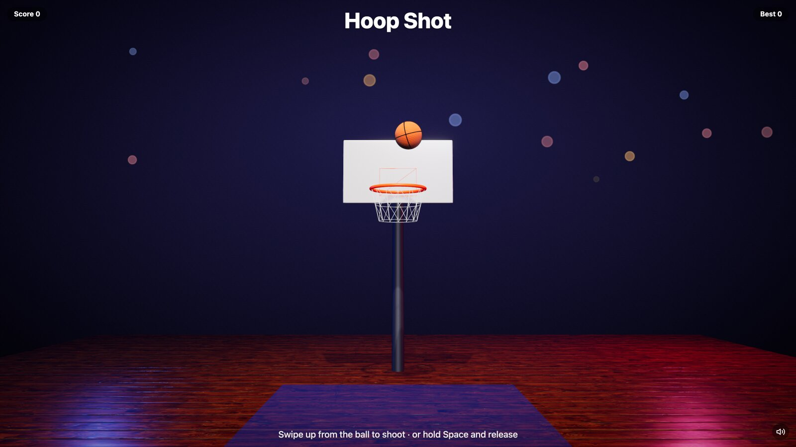<p align="center"><b>Hoop shot</b>: a playable game on rigid-body physics</p></td>
<td width="50%">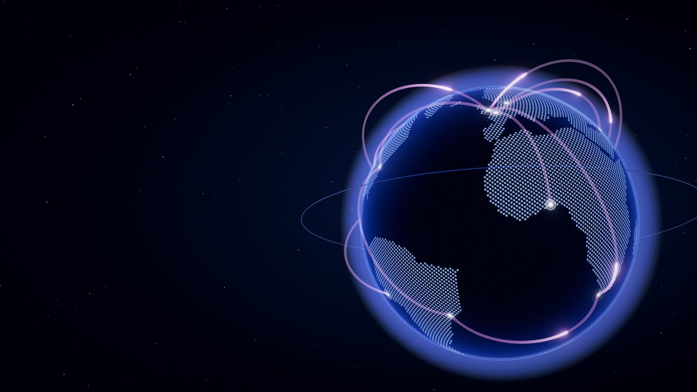<p align="center"><b>SaaS globe hero</b>: globe generator, arcs, room for your headline</p></td>
</tr>
</table>

<p align="center">
  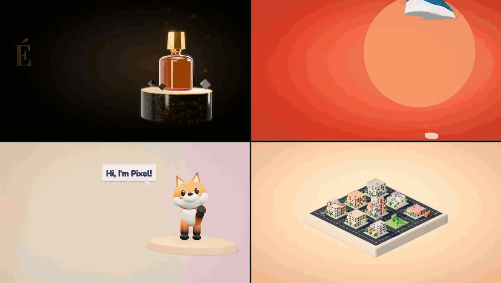
  <br><sub>Headless renders of the built-in templates, straight from <code>agent3d render</code>. Nothing was downloaded: everything is procedural or from the built-in library.</sub>
</p>

<p align="center">
  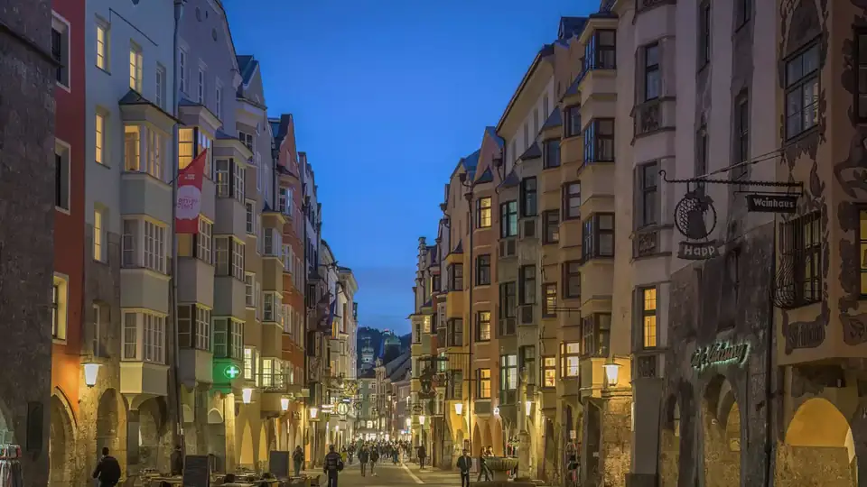
  <br><sub><b>3D photo</b>: one CC0 photo plus a depth map estimated locally in about a second (<code>agent3d assets depth</code>), moving in depth as the pointer sweeps across it. The <a href="https://github.com/fleox/agent3d/tree/main/templates/hero-photo-3d"><code>hero-photo-3d</code></a> template, rendered with <code>agent3d render --input</code>.</sub>
</p>

**Beyond parallax: what else an agent can do with one photo.** Every clip is a headless render (`agent3d render --video`, then converted to WebP for this page) of a demo scene; the line in quotes is what to ask your agent to get the same result on your own photo. CC0 photos, depth maps estimated locally.

<table>
<tr>
<td width="50%" valign="top">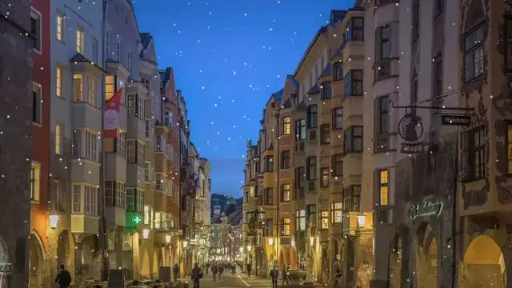<br><b>3D inside the photo</b> (<code>occlude</code>)<br><i>"Put the OLD TOWN title inside the photo, behind the foreground buildings, with snow falling in front and behind."</i></td>
<td width="50%" valign="top">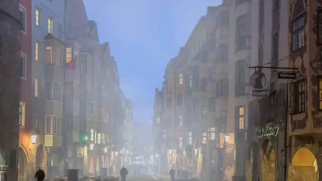<br><b>Depth fog</b> (<code>effects.fog</code>)<br><i>"Add a bluish mist in the background of the photo."</i></td>
</tr>
<tr>
<td valign="top"><br><b>A light that follows the pointer</b> (<code>effects.light</code>, normals from the depth map)<br><i>"Light the photo with a warm lamp that follows the mouse."</i></td>
<td valign="top"><br><b>Depth-by-depth reveal</b> (<code>effects.reveal</code>)<br><i>"Make the photo appear from the background to the front in 3 seconds."</i></td>
</tr>
<tr>
<td valign="top">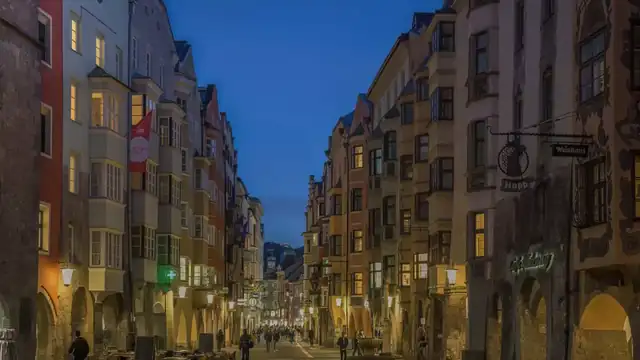<br><b>Effects on the timeline</b><br><i>"Sweep a light across the street while the mist rises."</i></td>
<td valign="top"><br><b>Rack focus</b> (<code>effects.blur</code>, depth-aware lens blur)<br><i>"Add a focus pull from the foreground to the background."</i></td>
</tr>
<tr>
<td valign="top"><br><b>Out of frame</b> (<code>effects.frame</code>)<br><i>"Put the photo in a frame and make the subject step out of it."</i></td>
<td valign="top">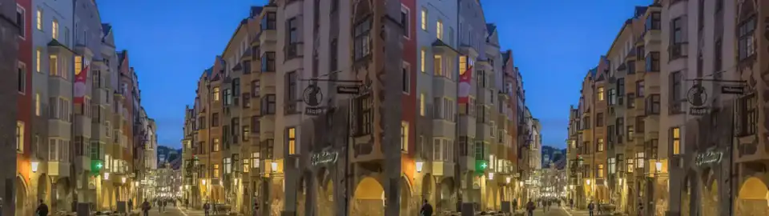<br><b>Background plate</b> for bigger moves (<code>assets plate</code>): left without, right with<br><i>"Prepare the photo for bigger camera moves."</i></td>
</tr>
<tr>
<td valign="top">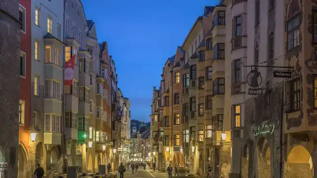<br><b>Dolly</b> (<code>motion.auto</code>: dolly, pan, rise, vertigo)<br><i>"Do a dolly-in on the photo."</i></td>
<td valign="top"><br><b>Vertigo</b> (dolly zoom)<br><i>"Do a vertigo effect on the photo."</i></td>
</tr>
<tr>
<td valign="top">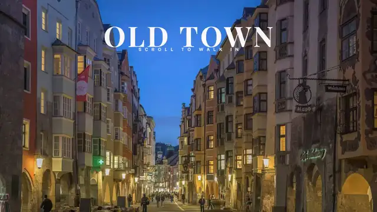<br><b>Scroll story</b> (the <code>photo-scroll-story</code> template, filmed with simulated scrolling)<br><i>"Make a scroll story: we walk down the street, then arrive at the lake."</i></td>
<td valign="top" align="center">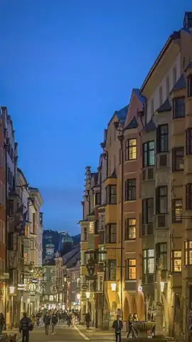<br><b>Social video</b> (<code>render --video reel.mp4 --preset vertical</code>: 1080×1920, one seamless loop)<br><i>"Make me a vertical Instagram video with a vertigo effect on this photo."</i></td>
</tr>
</table>

**Look**
- **Lighting and lookdev**: 10 one-line light rigs (softbox, studio three-point, golden hour, neon, moonlight…), physical skies with a matching sun, 20 built-in HDRIs, height fog, contact shadows, rect panel lights and volumetric spots, mesh-gradient backgrounds
- **Materials**: 38 presets from chrome, glass and car paint to velvet, diamond and soap bubble; physical parameters (clearcoat, sheen, iridescence, transmission, anisotropy, dispersion), 12 procedural textures (marble, wood, terrazzo, carbon…) at zero bytes, 17 shaders (aurora, liquid chrome, nebula, caustics…), cel shading that keeps brand colours true
- **Finishing**: `look` presets (cinematic, product, dreamy, neon, retro, clean) and 20 post effects: bloom, ambient occlusion, depth of field with rack focus, god rays, lens flare, tilt-shift, grading, vignette, film grain, FXAA / SMAA / TAA…; quality tiers drop costly passes on weak devices

**Motion**
- 29 **behaviours** (float, orbit, follow or look at the pointer, tilt, hover lift, spin on click, scroll parallax, spring, breathe…)
- A keyframe **timeline** with every easing, springs, per-letter and staggered multi-target tracks, colour blends in OKLCh, markers and **segments**
- **Interactions** (hover, click, key) that play segments, set properties or open links; **scroll-driven** timelines; cinematic **camera shots**, shake and look-at

**Content**
- 22 procedural **generators**: terrain (mountains, basins, valleys, islands), trees, rocks, grass, flowers, water with mirror reflections, clouds, birds, cities, roads, floating islands, globes, galaxies, crystals, 3D bar charts, mazes… deterministic from a seed
- A procedural **character** generator (humanoid, astronaut, robot, blob, cat, fox, bird, ghost) with animations such as wave, run, jump, dance and celebrate
- A built-in **library** of 179 assets usable offline (`library:<id>`): 128 models (rigged characters with clips, products, props), PBR textures and HDRIs; optional search and download from free CC0 sources (Poly Haven, ambientCG, Khronos samples) and Kenney / Quaternius pack import, with licences recorded
- **3D photos**: any photo plus a depth map estimated on your machine (`assets depth`: Depth Anything V2 Small, a 27 MB model downloaded once, then offline) moves in depth with the pointer, the phone's gyroscope, the scroll or a gentle automatic drift — shader parallax, a displaced mesh or pop-up layers. 3D text, models and particles can live *inside* the photo, hidden by its foreground (`occlude`); depth-driven effects (fog, a light that follows the pointer, a depth-by-depth reveal, rack focus, out-of-frame pop-out); a background plate rebuilt behind the foreground for bigger camera moves (`assets plate`); cinematic moves (dolly, pan, rise, vertigo) and one-command social videos (`render --video --preset vertical`); scroll stories that dive into photos. A photo-only hero exports with a ~19 KB player instead of three.js
- 3D text in 13 kerned **fonts** with wrapping, outlines and letter-by-letter reveals; extruded **SVG logos** that keep their colours; 17 particle presets; 12 synth sounds

**Games**
- Sandboxed **scripts** (`ScriptApi`: input, spawning by cloning, events, sounds, saved best scores); `check` rejects network, DOM and storage globals before export
- Rigid-body **physics** (shapes, joints with motors, collision events, character controllers, moving platforms) in a lazy chunk
- A themable **HUD** (texts bound to the game state, bars, buttons, panels for game-over screens), keyboard, pointer and touch-swipe input, and an attract mode so the embed is alive before anyone plays

**Web**
- The `<agent3d-scene>` **Web Component**: lazy start when scrolled into view, pause off-screen, `prefers-reduced-motion`, pixel-ratio cap, a poster without WebGL or JavaScript, reserved aspect ratio, `aria-label`, methods and events
- **Data bindings**: `{data.title}` in the scene, filled per page with `data-*` attributes (one scene, many products)
- **Exports**: an embed folder (shared runtime, Subresource Integrity, `EMBED.md`, React / Vue / Svelte wrappers), a ZIP, a single HTML file, a poster, an MP4 / WebM video or a GIF; the export reports the real page weight a visitor downloads
- Works in plain HTML, WordPress, Webflow, Shopify, AgentCMS ([block](https://github.com/fleox/agent3d/tree/main/integrations/agentcms)), React / Next.js, Astro, Vue, Svelte; a strict Content-Security-Policy works without `unsafe-eval`

**Quality**
- **Headless renders** in your installed Chrome with a deterministic clock: frames and contact sheets are reproducible, and games are *played* with simulated keys, taps and swipes (`render --input`) with the script's state returned
- **`check`**: validation, missing files, the script sandbox, triangles and draw calls per frame across every pass against the target's aim, KB budgets, framing, accessibility settings, licences that need credit

## The Studio

A visual editor for when you want to see and touch the scene yourself, on the same files and the same validated tools as the agent. Changes your agent makes in a terminal appear live in the open Studio.

```bash
npx -y @fleox/agent3d@0.5.1 studio --project bakery
```

<p align="center">
  <picture>
    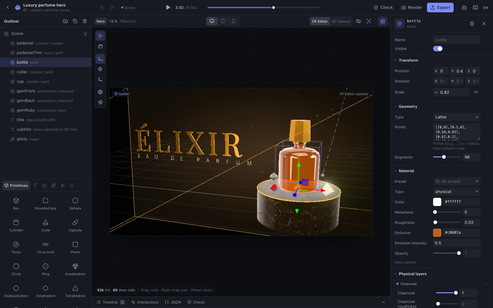
  </picture>
</p>

<table>
<tr>
<td width="50%">
  <picture>
    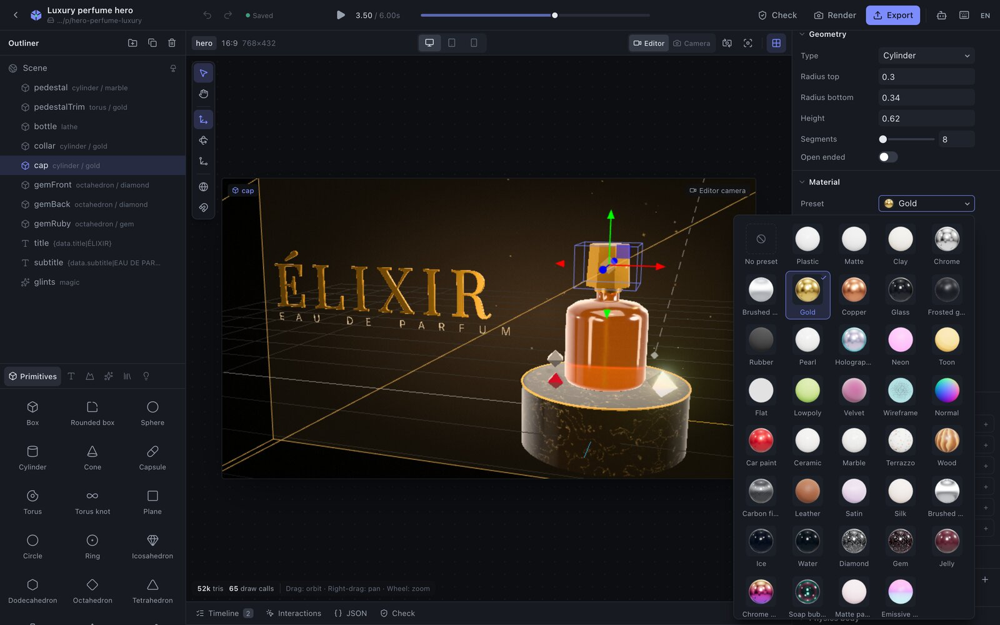
  </picture>
  <p align="center"><b>Materials</b>: presets, physical parameters, procedural textures</p>
</td>
<td width="50%">
  <picture>
    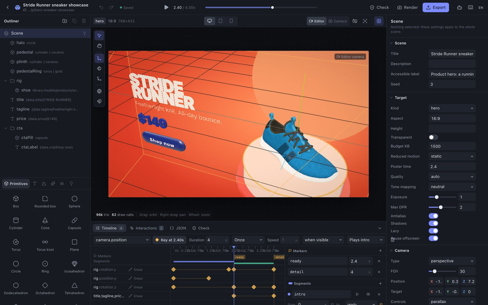
  </picture>
  <p align="center"><b>Timeline</b>: tracks, keyframes, easings, segments</p>
</td>
</tr>
<tr>
<td width="50%">
  <picture>
    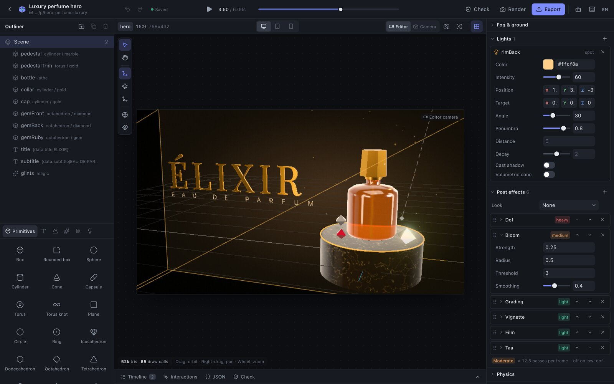
  </picture>
  <p align="center"><b>Post effects</b>: looks, bloom, depth of field, grading</p>
</td>
<td width="50%">
  <picture>
    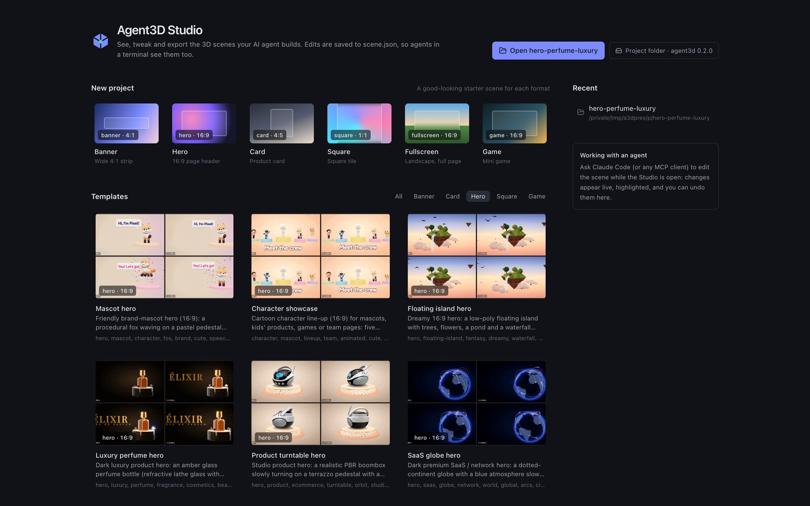
  </picture>
  <p align="center"><b>Start</b>: templates gallery and starters per target</p>
</td>
</tr>
</table>

Move / rotate / scale gizmos, an editor camera and the scene camera with framing guides, drag and drop from the catalog and the library, outliner, inspector, interactions, checks, render and export dialogs, undo / redo, in English or French. An optional assistant panel calls the Claude API from your browser with your own key, over the same tools. `serve --open` shows a live preview without the editor. Details: [docs/studio.md](https://github.com/fleox/agent3d/blob/main/docs/studio.md).

## Templates

<p align="center">
  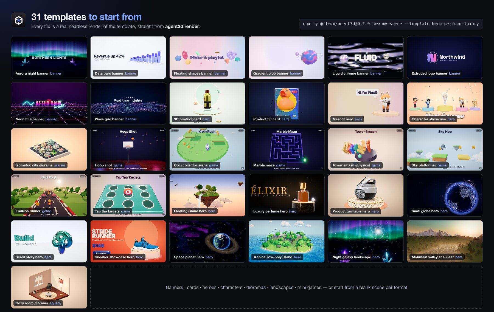
</p>

34 starter projects, each a complete scene that passes `check --render`: 8 banners, 15 heroes and landscapes, 2 product cards, 2 square dioramas and 7 playable games. Start from one with `agent3d new my-scene --template <id>`; `agent3d templates list` lists them and `templates show <id>` describes one.

To see them all live in a browser, build the gallery from a clone (`npm install --legacy-peer-deps && npm run build:runtime && npm run build:agent`, then `node scripts/build-examples.mjs`) and serve `examples/site/` with any static server (for example `python3 -m http.server -d examples/site`): each card plays the real embed, with the brief the agent that built the template received.

<details>
<summary><b>All 34 templates</b></summary>

| Preview | Template | Kind | What it is |
|---|---|---|---|
|  | [**Aurora night banner**](https://github.com/fleox/agent3d/tree/main/templates/banner-aurora-night)<br>`banner-aurora-night` | banner · 4:1 | Night-sky 4:1 banner: animated northern-lights curtains over low-poly mountain silhouettes, twinkling stars, glowing cyan and violet crystal clusters in the snow and a white headline (data-bound) fading in letter by letter. |
|  | [**Data bars banner**](https://github.com/fleox/agent3d/tree/main/templates/banner-data-bars)<br>`banner-data-bars` | banner · 4:1 | Clean corporate 4:1 banner: a two-row 3D bar chart (your values) growing bar by bar in indigo on a white base plate, next to a data-bound headline and caption — reports, fintech, analytics and investor pages. |
|  | [**Floating shapes banner**](https://github.com/fleox/agent3d/tree/main/templates/banner-floating-shapes)<br>`banner-floating-shapes` | banner · 4:1 | Pastel 4:1 banner: a rounded 3D headline (data-bound) popping in letter by letter, framed by jelly, pearl, matte-pastel and gold shapes that spring in, float and shift with the pointer in depth layers over a drifting mesh-gradient backdrop. |
|  | [**Gradient blob banner**](https://github.com/fleox/agent3d/tree/main/templates/banner-gradient-blob)<br>`banner-gradient-blob` | banner · 3:1 | Minimal 3:1 banner for SaaS / product pages: a glossy iridescent morphing blob in brand colours with a small companion blob, a thin chrome orbit with beads and a drifting pastel mesh-gradient backdrop; the left two thirds stay empty for your HTML headline. |
| 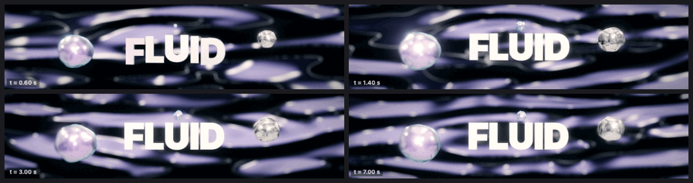 | [**Liquid chrome banner**](https://github.com/fleox/agent3d/tree/main/templates/banner-liquid-chrome)<br>`banner-liquid-chrome` | banner · 4:1 | Abstract 4:1 banner: a flowing liquid-chrome backdrop softly out of focus, morphing holographic and chrome blobs, and a bold kerned title (data-bound) revealed letter by letter from the centre, with cinematic grading and grain. |
| 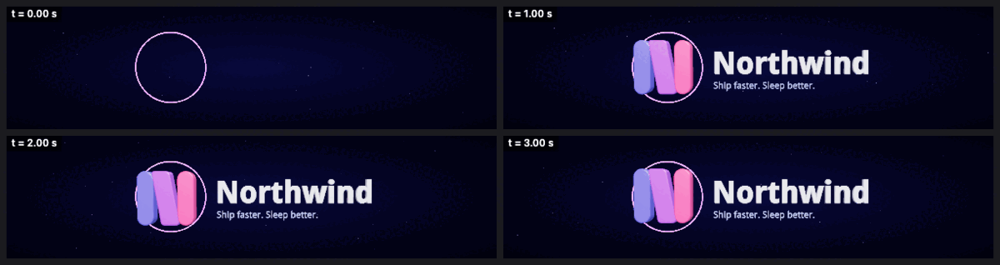 | [**Extruded logo banner**](https://github.com/fleox/agent3d/tree/main/templates/banner-logo-extrude)<br>`banner-logo-extrude` | banner · 4:1 | Brand 4:1 banner: your SVG logo extruded into clear-coated 3D (keeping its colours) inside a neon halo, a wordmark revealed letter by letter and a tagline (both data-bound), a light sweep across the logo; it tilts toward the pointer, spins on hover and bounces on click. |
|  | [**Neon title banner**](https://github.com/fleox/agent3d/tree/main/templates/banner-neon-title)<br>`banner-neon-title` | banner · 4:1 | Synthwave 4:1 banner: a tall condensed sunset-gradient 3D headline that drops in letter by letter from the centre, a flickering neon script tagline, neon tubes, a scrolling neon grid floor, a gradient sun, sparks and bloom (data-bound texts). |
|  | [**Wave grid banner**](https://github.com/fleox/agent3d/tree/main/templates/banner-wave-grid)<br>`banner-wave-grid` | banner · 4:1 | Dark tech / data 4:1 banner: a field of ~8,000 dots in a cyan-indigo-pink ramp undulating like a signal and rippling under the pointer, beneath a crisp Space Grotesk headline revealed letter by letter and a blinking mono kicker (data-bound). |
| 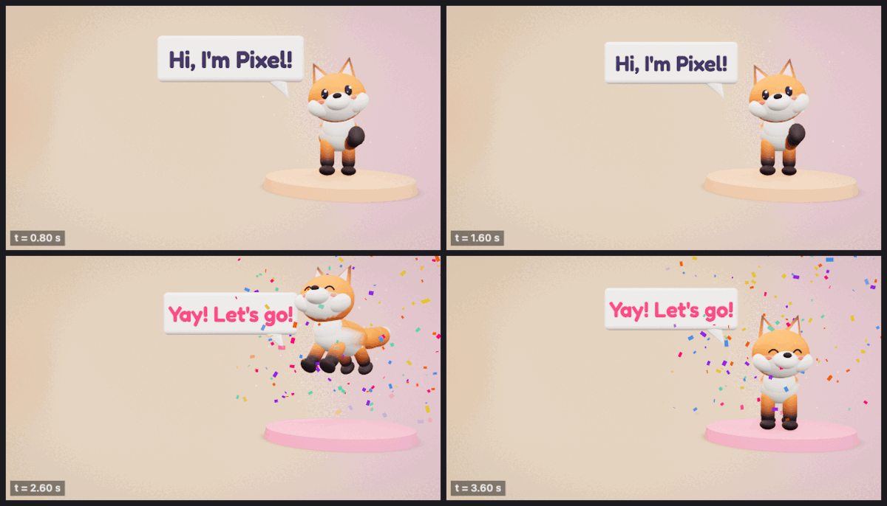 | [**Mascot hero**](https://github.com/fleox/agent3d/tree/main/templates/character-mascot-hero)<br>`character-mascot-hero` | hero · 16:9 | Friendly brand-mascot hero (16:9): a procedural fox waving on a pastel pedestal with a 3D speech bubble (text from scene.data), its head and eyes following the pointer; click or tap it and it jumps into a celebration with confetti and a new line, then settles back. |
|  | [**Character showcase**](https://github.com/fleox/agent3d/tree/main/templates/character-showcase)<br>`character-showcase` | hero · 16:9 | Cartoon character line-up (16:9) for mascots, kids' products, games or team pages: five procedural characters on pastel pedestals — an astronaut cheering in the centre, a dancing robot, a waving fox, a dancing kid with headphones and a jumping cat — heads following the pointer, falling confetti and a 'Meet the crew' 3D title (from scene.data). |
|  | [**Floating island hero**](https://github.com/fleox/agent3d/tree/main/templates/hero-floating-island)<br>`hero-floating-island` | hero · 16:9 | Dreamy 16:9 hero: a low-poly floating island with trees, flowers, a pond and a waterfall pouring into a sea of pastel clouds, two distant islets, flapping birds circling and magic glints, under a peach-to-blue sunset gradient — slow orbit, pointer parallax, soft dreamy look. |
|  | [**Luxury perfume hero**](https://github.com/fleox/agent3d/tree/main/templates/hero-perfume-luxury)<br>`hero-perfume-luxury` | hero · 16:9 | Dark luxury product hero: an amber glass perfume bottle (refractive lathe glass with liquid colour) and faceted gold cap on a black-and-gold marble pedestal, diamonds and a ruby catching the light, a slow push-in with a rack focus from a diamond to the bottle, and a gold serif name (data-bound). |
| 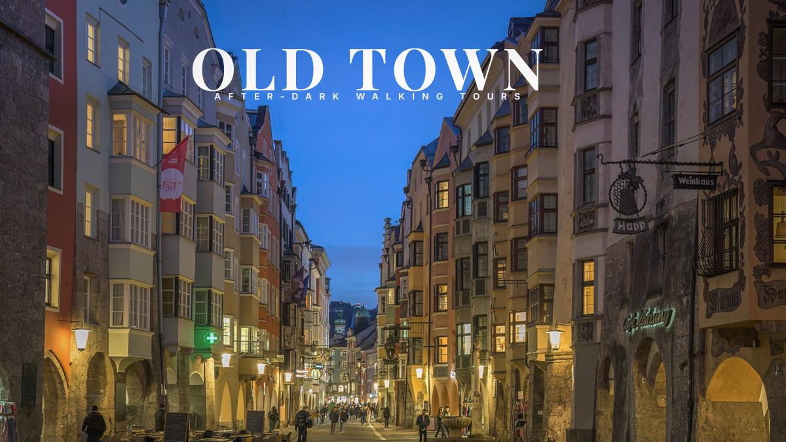 | [**3D photo hero**](https://github.com/fleox/agent3d/tree/main/templates/hero-photo-3d)<br>`hero-photo-3d` | hero · 16:9 | A photo brought to life: a blue-hour old-town street (CC0) turned into a 3D photo with its estimated depth map, moving in depth with the pointer, the phone's gyroscope and a gentle automatic sway, under a white serif headline and subtitle (data-bound). |
|  | [**3D title inside a photo**](https://github.com/fleox/agent3d/tree/main/templates/photo-title-inside)<br>`photo-title-inside` | hero · 16:9 | 3D inside a 3D photo: a big 3D title placed between the far houses and the nearest building of a blue-hour old-town street (CC0), so the facade hides part of the letters, with snow falling in front of and behind the buildings; the photo writes its depth (`occlude: true`) and its motion moves the real camera, so the title slides exactly with the street. |
|  | [**Product turntable hero**](https://github.com/fleox/agent3d/tree/main/templates/hero-product-turntable)<br>`hero-product-turntable` | hero · 16:9 | Studio product hero: a realistic PBR boombox slowly turning on a terrazzo pedestal with a gold rim, softbox light rig, studio HDRI reflections, soft contact shadow, product look and drag-to-orbit. |
| 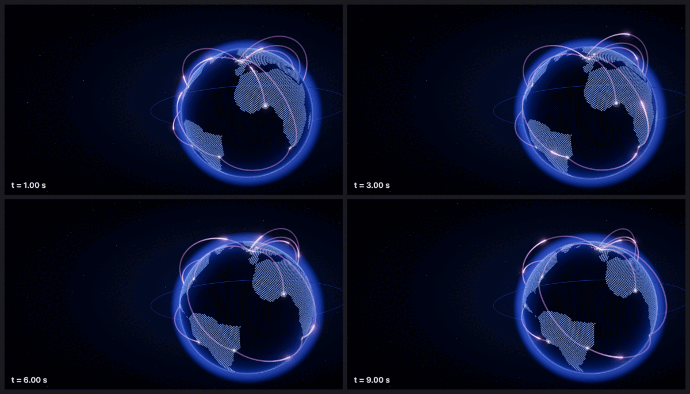 | [**SaaS globe hero**](https://github.com/fleox/agent3d/tree/main/templates/hero-saas-globe)<br>`hero-saas-globe` | hero · 16:9 | Dark premium SaaS / network hero: a dotted-continent globe with a blue atmosphere slowly turning on the right, glowing arcs with light pulses travelling between world cities, faint orbit ring and stars; the left half stays empty for your HTML headline. |
|  | [**Scroll story hero**](https://github.com/fleox/agent3d/tree/main/templates/hero-scroll-story)<br>`hero-scroll-story` | hero · 16:9 | Scroll-driven 3D story: as the page scrolls, the camera glides across three chapters — Design, Build, Launch — each with its own object and a bold 3D title that pops in letter by letter, with markers that emit page events. |
|  | [**Sneaker showcase hero**](https://github.com/fleox/agent3d/tree/main/templates/hero-sneaker-showcase)<br>`hero-sneaker-showcase` | hero · 16:9 | E-commerce product hero: a real PBR sneaker spins onto a ceramic pedestal on a bold coral backdrop, with a data-bound title, tagline, price and Shop now button; click the shoe to glide the camera to a detail view. |
| 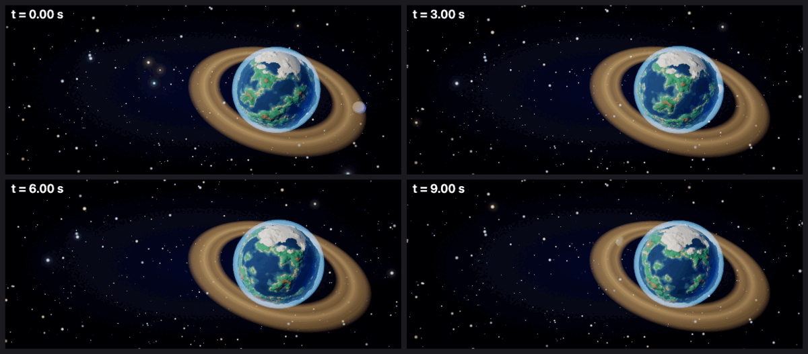 | [**Space planet hero**](https://github.com/fleox/agent3d/tree/main/templates/hero-space-planet)<br>`hero-space-planet` | hero · 21:9 | Cinematic 21:9 space hero: a ringed low-poly planet side-lit into a crescent, an orbiting moon, a drifting purple-blue nebula backdrop, twinkling stars, nebula dust and a comet, bloom + lens flare + film grade, drifting with the pointer — left half free for a headline. |
| 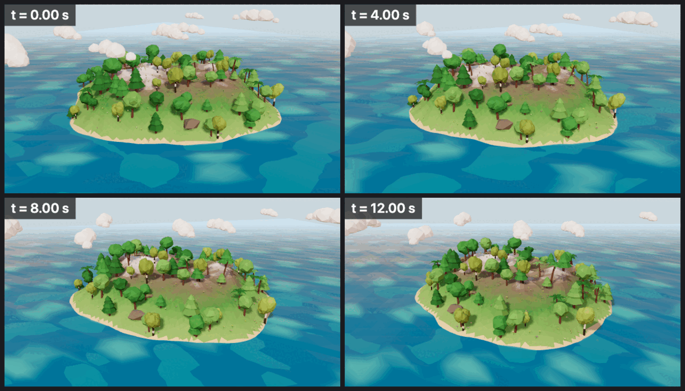 | [**Tropical low-poly island**](https://github.com/fleox/agent3d/tree/main/templates/landscape-island)<br>`landscape-island` | hero · 16:9 | Sunny 16:9 procedural diorama: a tropical low-poly island (palm-lined beaches, round-canopy forest, rocky summit) in turquoise lagoon water with animated shore foam, puffy clouds and seabirds circling, cinematic grade, slow orbit + drag. |
|  | [**Night galaxy landscape**](https://github.com/fleox/agent3d/tree/main/templates/landscape-night-galaxy)<br>`landscape-night-galaxy` | hero · 16:9 | Calm 16:9 night hero: glowing crystal clusters (purple, cyan, pink) on dark low-poly hills under a vast rotating spiral galaxy, northern-lights aurora curtains, twinkling stars and drifting fireflies, bloom and a cool grade, slow 20 s camera drift + pointer parallax. |
|  | [**Mountain valley at sunset**](https://github.com/fleox/agent3d/tree/main/templates/landscape-valley-sunset)<br>`landscape-valley-sunset` | hero · 21:9 | Atmospheric 21:9 landscape: a low-poly mountain valley closed by a snowy range, a pine forest and an animated lake under a physical golden-hour sky, the sun low at the edge of the frame with soft god rays, valley height fog, pink clouds and fireflies — cinematic grade, slow camera drift + pointer parallax. |
| 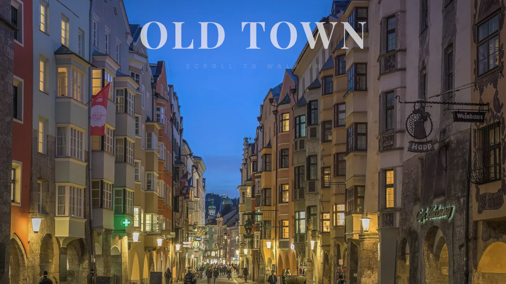 | [**Photo scroll story**](https://github.com/fleox/agent3d/tree/main/templates/photo-scroll-story)<br>`photo-scroll-story` | hero · 16:9 | A scroll-driven hero made of two 3D photos (CC0): scrolling dives down a blue-hour street (dolly), dissolves into a mountain lake and ends on a dolly zoom, with headlines fading between the chapters (data-bound). |
|  | [**3D product card**](https://github.com/fleox/agent3d/tree/main/templates/card-hover-3d)<br>`card-hover-3d` | card · 4:5 | Clean product card (4:5): a PBR water bottle turning over a glossy sage disc with a soft contact shadow, softbox lighting and product look; it lifts, tilts toward the pointer and grows on hover, with a data-bound name, price and link — drop it into any product grid. |
|  | [**Product tilt card**](https://github.com/fleox/agent3d/tree/main/templates/card-product-tilt)<br>`card-product-tilt` | card · 4:5 | Collectible-style product card (4:5): a glossy PBR rubber duck pops out of a holographic-foil card with a sun disc, tilting toward the pointer with a shifting rainbow glare; data-bound name, price, badge and link — drop it in any product grid. |
|  | [**Isometric city diorama**](https://github.com/fleox/agent3d/tree/main/templates/diorama-city)<br>`diorama-city` | square · 1:1 | A Townscaper-like isometric city block (1:1): pastel procedural buildings with lit windows, a park and street trees on a floating clay slab, library cars, a taxi and a police car driving the streets, low warm sun with long soft shadows, tilt-shift miniature blur and a cinematic grade, slow orbit. |
|  | [**Cozy room diorama**](https://github.com/fleox/agent3d/tree/main/templates/scene-cozy-room)<br>`scene-cozy-room` | square · 1:1 | Isometric cozy living-room corner (1:1) at golden hour: photoreal Poly Haven props (modern armchair, round coffee table, potted succulents) on a wooden floor with a striped rug, a glowing floor lamp, a window area light with dust drifting in the light, framed art, soft VSM shadows, cinematic warm grade and a slow camera sway. |
|  | [**Hoop shot**](https://github.com/fleox/agent3d/tree/main/templates/game-basket)<br>`game-basket` | game · 16:9 | Playable 45-second basketball shooting game (16:9) on real rigid-body physics: swipe or drag up to shoot (length = power, drift = aim) or hold Space to charge and release, the ball bounces off a trimesh rim and the backboard, swishes count only when falling through the net, a new spot after every shot, x2 / x3 streaks, best score saved, impact sounds, confetti, spotlit night arena, self-playing attract mode. |
| 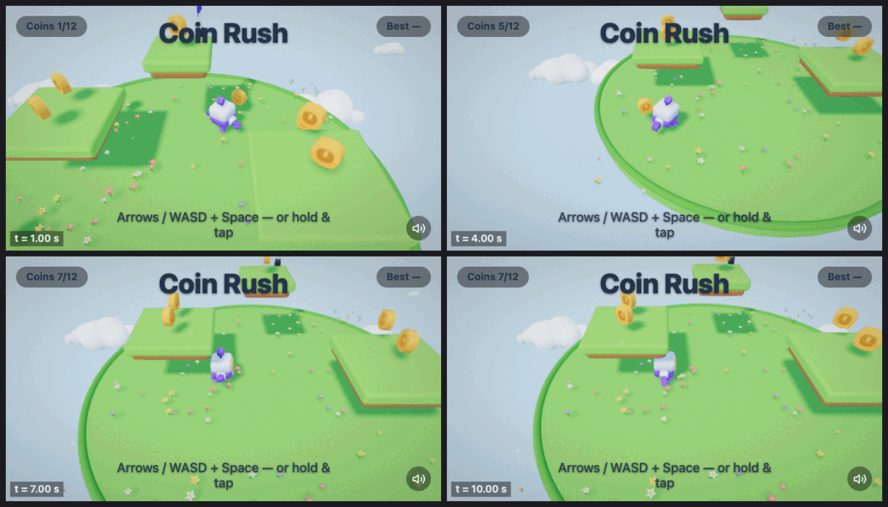 | [**Coin collector arena**](https://github.com/fleox/agent3d/tree/main/templates/game-coin-collector)<br>`game-coin-collector` | game · 16:9 | Playable 3D platformer arena (16:9): run and jump across a floating grass island and stepped platforms above a sea of clouds to collect 12 coins before the 45 s timer ends — physics, follow camera, best time, keyboard + touch, self-playing attract mode. |
|  | [**Marble maze**](https://github.com/fleox/agent3d/tree/main/templates/game-maze)<br>`game-maze` | game · 1:1 | Playable marble maze: roll a glossy ball through a procedural maze to the glowing exit against the clock — physics walls, best time, keyboard + touch, self-solving attract mode. |
|  | [**Tower smash (physics)**](https://github.com/fleox/agent3d/tree/main/templates/game-physics-playground)<br>`game-physics-playground` | game · 16:9 | Rigid-body physics playground: click or tap to throw balls at a tower of wooden blocks that really tumbles, slides and stacks — knock it all off in as few throws as possible, impact sounds, best score, attract mode. |
| 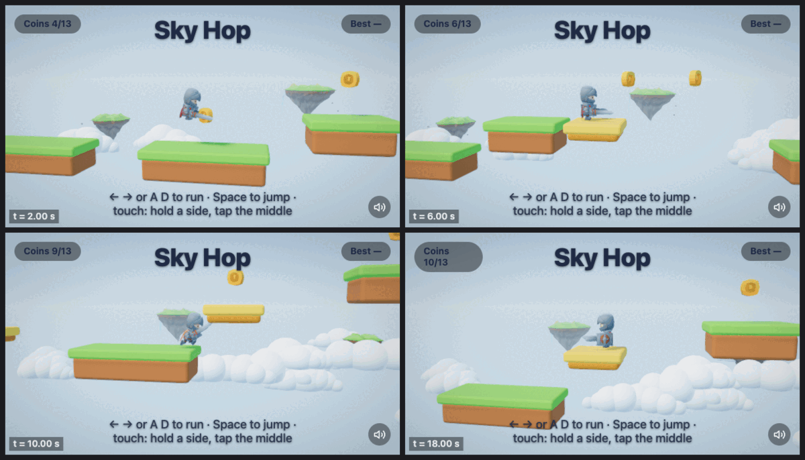 | [**Sky platformer**](https://github.com/fleox/agent3d/tree/main/templates/game-platformer)<br>`game-platformer` | game · 16:9 | Playable side-scrolling platformer (16:9): a rigged KayKit knight runs and jumps (physics character controller with coyote time) across floating grass platforms, a sliding lift and an elevator lift, collects 13 coins and reaches the goal flag against a 90 s timer — 3 lives, checkpoints, best time saved, synth sounds, keyboard + touch (hold a side to run, tap the middle to jump), self-playing attract mode, floating islands and clouds behind. |
| 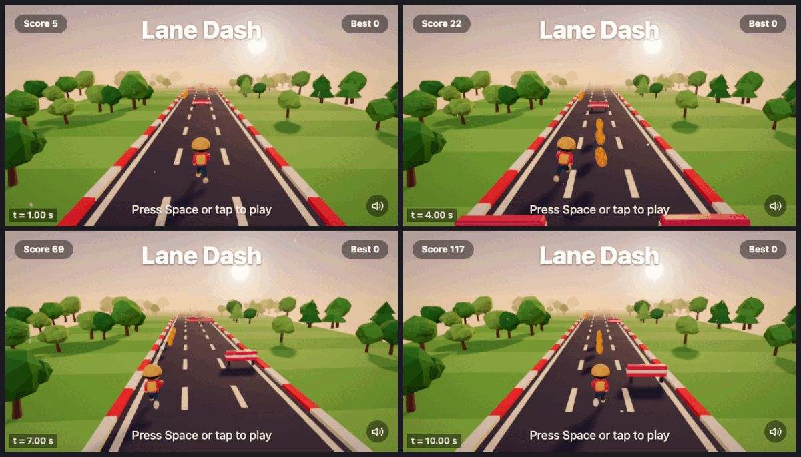 | [**Endless runner**](https://github.com/fleox/agent3d/tree/main/templates/game-runner)<br>`game-runner` | game · 16:9 | Playable endless runner: switch lanes and jump over barriers on a scrolling road, grab coins, speed ramps up, best score saved, game over + retry, synth sounds, keyboard + touch, self-playing attract mode. |
| 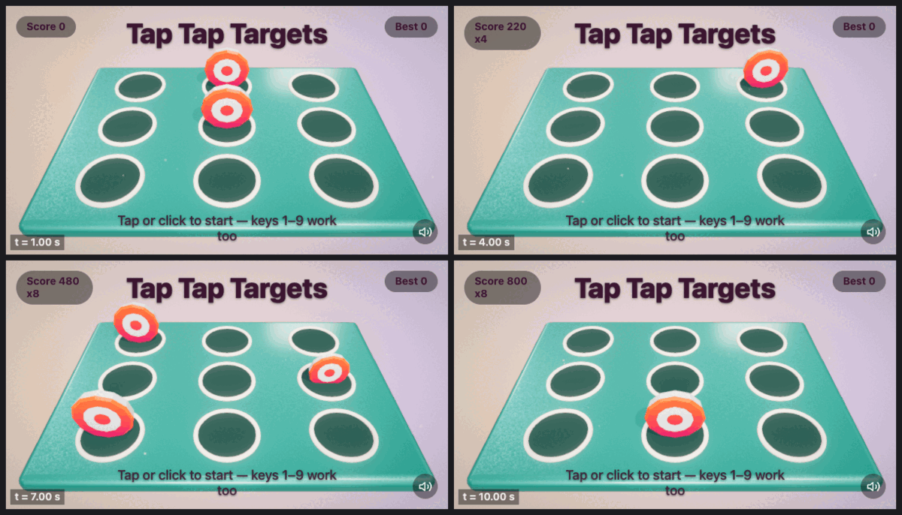 | [**Tap the targets**](https://github.com/fleox/agent3d/tree/main/templates/game-tap-targets)<br>`game-tap-targets` | game · 16:9 | Playable 30-second reflex game: targets pop out of nine holes, tap or click them, chain hits for a combo multiplier, golden targets score 5× — best score saved, touch + keyboard, attract mode. |

</details>

## How it works

<p align="center">
  <picture>
    <source media="(prefers-color-scheme: dark)" srcset="https://raw.githubusercontent.com/fleox/agent3d/main/.github/assets/how-it-works-dark.png">
    
  </picture>
</p>

All the rules live in one engine. The Studio, the CLI, the MCP server and the Studio assistant are four front doors to it, so an agent can do exactly what you can do in the editor, with the same validation. The engine works on a plain **project folder** (`scene.json`, `assets/`, `scripts/`, `renders/`), which you can keep in git.

A scene is data: the runtime is a pure function of (scene, assets, time) in deterministic mode. That is what makes the loop work: the agent edits the JSON, `render` seeks exact times in your headless Chrome and writes PNGs and a contact sheet, the agent **looks** at them, fixes, and `check` measures what a reviewer would. The same runtime plays the scene on your website, loaded in lazy chunks so a scene only downloads the features it uses.

The network is used only for the optional CC0 asset search and download (files are saved once into the project with their licence, and exports never hotlink) and, if you enable it, the Studio assistant's calls to the Claude API with your own key. Game scripts are checked against a sandbox contract before export. See [architecture](https://github.com/fleox/agent3d/blob/main/docs/architecture.md) and [security](https://github.com/fleox/agent3d/blob/main/docs/security.md).

```html
<script type="module" src="/agent3d/agent3d-runtime/agent3d-runtime.js"></script>
<agent3d-scene src="/agent3d/bakery/scene.json" poster="/agent3d/bakery/poster.webp"
               aria-label="Golden Crust Bakery: a warm 3D title with floating pastries"></agent3d-scene>
```

## How Agent3D compares

| | Agent3D | Spline | A hand-coded Three.js page | Lottie or a video loop |
|---|---|---|---|---|
| What you get | interactive 3D scenes for web pages | interactive 3D scenes for web pages | anything you write | 2D vector animation / pre-rendered frames |
| How it is made | JSON scene written by an agent or in the Studio | visual editor in the browser | code | an animation tool / a video editor |
| Account or hosted service | ❌ none | a Spline account | ❌ none | ❌ none |
| AI agent loop (edit, render, look, check) | ✅ CLI, MCP, skills | — | ad hoc | — |
| Hover, click, scroll, mini games | ✅ declared in the scene, scripts for games | ✅ | ✅ you write it | limited / ❌ |
| Budget and accessibility checks before publishing | ✅ `check` (triangles, KB, framing, reduced motion, label) | — | you write them | — |
| Output | static files, a Web Component | Spline's viewer / runtime | your build | a JSON file and a player / a video file |

Pick Spline when a designer wants a hosted visual tool, hand-written Three.js when you need full control of every line, and Lottie or video for flat or non-interactive motion. Agent3D fits when an agent should produce and verify the 3D element, and the result must ship as plain static files.

## The `agent3d` CLI

The same engine the agents use, by hand: `npx -y @fleox/agent3d@0.5.1 help`. Every command accepts `--json` and prints exactly one `{ ok, data }` or `{ ok: false, error }` object with an actionable hint, and commands that replace or overwrite something print a plan until you add `--yes`.

<p align="center">
  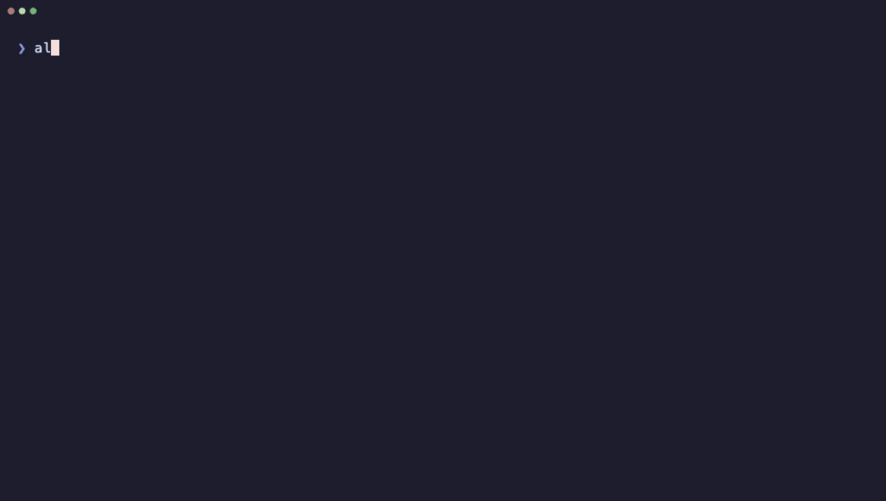
  <br><sub>Create, inspect and patch a scene from a terminal or a script; mistakes come back with a hint.</sub>
</p>

Render it headless and look, then export:

<p align="center">
  
  <br><sub><code>render --sheet</code> in your own headless Chrome: the picture the agent looks at, with the stats <code>check</code> uses.</sub>
</p>

<p align="center">
  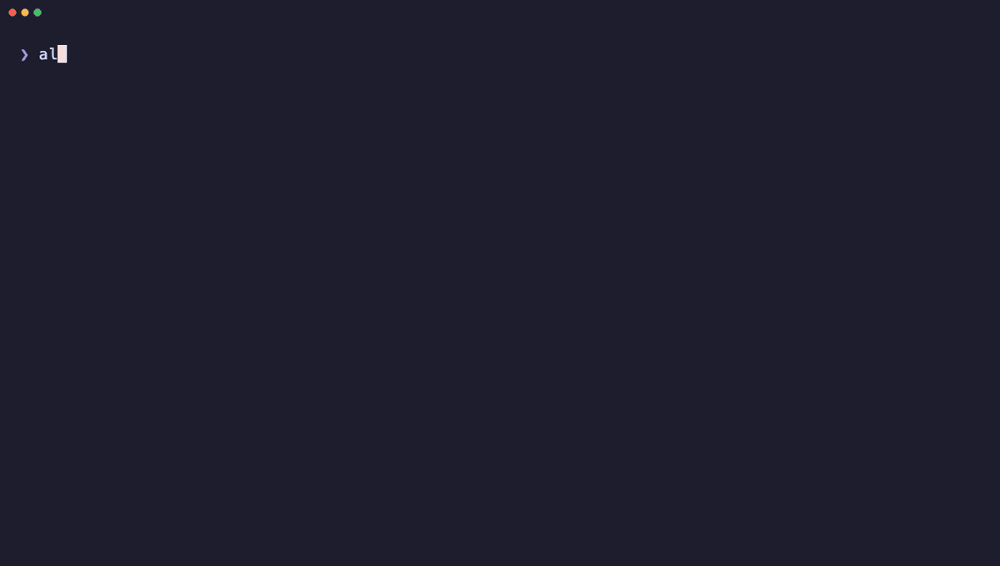
  <br><sub><code>export</code>: a plan before overwriting, the real page weight, the snippet to paste, and a video teaser (its frame-by-frame render is sped up ×8, labelled).</sub>
</p>

<details>
<summary><b>All commands</b></summary>

| Area | Commands |
|---|---|
| Project | `new <dir> [--template] [--target] [--title] [--aspect]`, `info`, `templates list\|show`, `doctor`, `version`, `help` |
| Scene | `scene get\|summary\|apply\|patch\|validate`, `object add\|update\|remove\|list\|get\|move`, `timeline get\|set\|add-track\|remove-track`, `catalog [section] [id]` |
| Look at it | `render [--sheet] [--frames] [--size] [--input] [--segment] [--scroll] [--reduced-motion] [--video\|--gif\|--webp]`, `check [--render]`, `serve [--open]`, `studio` |
| Ship | `export [--format embed\|zip\|single-html\|poster\|video\|gif] [--out] [--optimize] [--base-url] [--prune-runtime]` |
| Assets | `assets list\|search\|add\|optimize\|remove\|library` |
| AI | `tools list\|call`, `mcp [--read-only]` |

Full reference: [docs/cli.md](https://github.com/fleox/agent3d/blob/main/docs/cli.md).

</details>

## MCP server

```bash
claude mcp add agent3d -- npx -y @fleox/agent3d@0.5.1 mcp --project ~/agent3d/my-banner
```

<p align="center">
  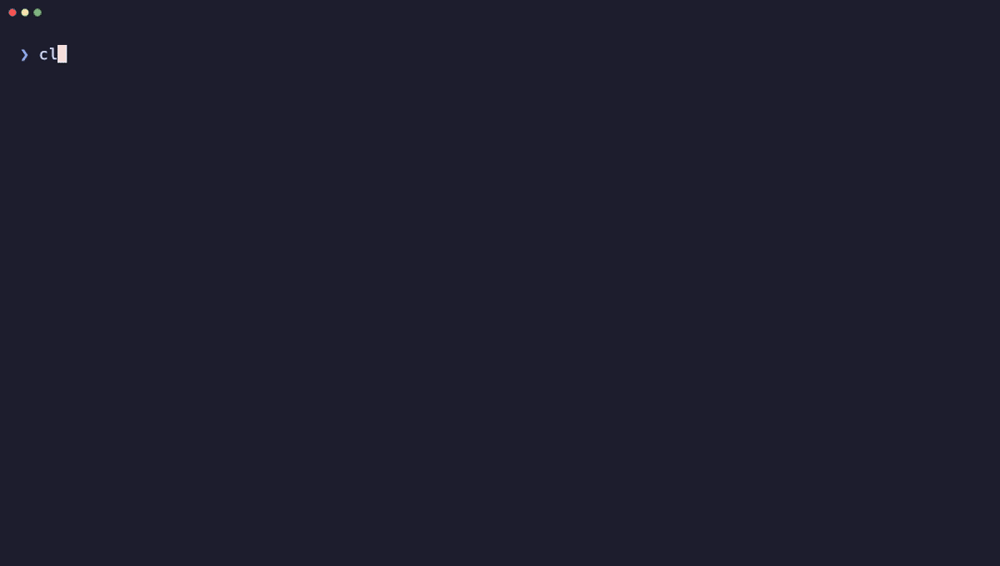
</p>

**Tools** are the shared AI catalog: project info and creation, scene get / summary / apply / patch / validate, objects, timeline, interactions, catalog and templates lookups, `check`, assets (list, search, add, optimize, library) and `export`, plus **`render_preview`**, which returns the contact sheet as an **image** so multimodal models see their work. **Resources** are the scene, its summary and the catalog. `--read-only` hides every tool that writes. The folder may be empty: `project_create` creates the project there. Claude Desktop, Cursor and Hermes setup: [docs/mcp.md](https://github.com/fleox/agent3d/blob/main/docs/mcp.md).

## Documentation

| | |
|---|---|
| [Getting started](https://github.com/fleox/agent3d/blob/main/docs/getting-started.md) | Install, a first banner in five commands, using it from an agent |
| [Art direction](https://github.com/fleox/agent3d/blob/main/docs/art-direction.md) | Premium defaults per kind: composition, lighting, palettes, motion |
| [Scene format](https://github.com/fleox/agent3d/blob/main/docs/scene-format.md) · [Catalog](https://github.com/fleox/agent3d/blob/main/docs/catalog.md) | `scene.json` field by field; every geometry, material, behaviour, generator and effect with parameters |
| [Scripting](https://github.com/fleox/agent3d/blob/main/docs/scripting.md) | Games and interactive logic: the ScriptApi, physics, HUD, sandbox rules, headless play-testing |
| [Export](https://github.com/fleox/agent3d/blob/main/docs/export.md) | Export formats, the `<agent3d-scene>` element, data bindings, frameworks, CSP, videos and GIFs |
| [Assets](https://github.com/fleox/agent3d/blob/main/docs/assets.md) | The built-in library, CC0 sources, `assets optimize`, licences |
| [Studio](https://github.com/fleox/agent3d/blob/main/docs/studio.md) · [Studio API](https://github.com/fleox/agent3d/blob/main/docs/studio-api.md) | The visual editor; its local REST API |
| [CLI](https://github.com/fleox/agent3d/blob/main/docs/cli.md) · [MCP](https://github.com/fleox/agent3d/blob/main/docs/mcp.md) | Every command; MCP clients |
| [Architecture](https://github.com/fleox/agent3d/blob/main/docs/architecture.md) · [Security](https://github.com/fleox/agent3d/blob/main/docs/security.md) | The engine, the runtime, the render loop; what touches the network, the script sandbox |
| [AGENTS.md](https://github.com/fleox/agent3d/blob/main/AGENTS.md) | Instructions for AI agents working on this repository |

## Contributing

Bug reports and ideas are welcome: [open an issue](https://github.com/fleox/agent3d/issues/new/choose). Read [CONTRIBUTING.md](https://github.com/fleox/agent3d/blob/main/CONTRIBUTING.md) before opening a pull request. For security issues, follow [SECURITY.md](https://github.com/fleox/agent3d/blob/main/SECURITY.md) instead of opening a public issue.

```bash
npm install --legacy-peer-deps
npm run dev        # the Studio (projects in the browser)
npm test           # Vitest
npm run build      # runtime + Studio + CLI
```

## License

Source-available under the [PolyForm Noncommercial License 1.0.0](https://github.com/fleox/agent3d/blob/main/LICENSE). Personal, hobbyist, educational, research and other noncommercial use is free, and you can fork, modify and redistribute under the same terms.

**Commercial use requires written authorization.** This includes selling the software or hosting it as a paid service. For a commercial license, [open an issue](https://github.com/fleox/agent3d/issues).

Agent3D renders with [three.js](https://threejs.org), runs physics with [cannon-es](https://github.com/pmndrs/cannon-es) and decodes compressed models with [meshoptimizer](https://github.com/zeux/meshoptimizer) (all MIT). The built-in library is CC0, with OFL / Apache-2.0 fonts and a few CC BY models whose credits exports list: see [library/LICENSES.md](https://github.com/fleox/agent3d/blob/main/library/LICENSES.md).
