# Agent3D

**The 3D studio your AI agent can run.** Ask for "an animated banner for my bakery", "a mountain-lake hero at golden hour" or "a mini game where you dodge blocks": your agent writes the scene as JSON, renders it headless with your own Chrome, **looks at the screenshots**, fixes what it sees, checks budgets and accessibility, and exports a self-contained embed for any website.

No server, no account, no CDN, no tracking. The output is a Web Component and a few static files (or one HTML file) that you drop on any site.

| | | |
|---|---|---|
| 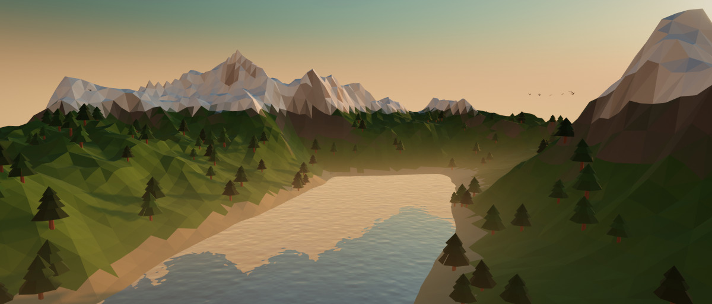 | 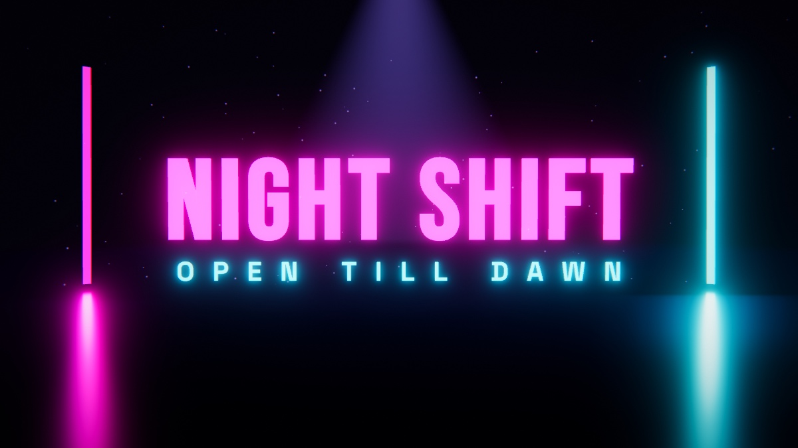 | 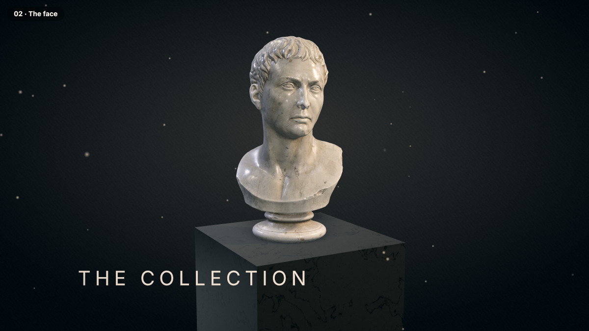 |
| Landscape: physical sky, mirror lake, birds (21:9) | Neon title: panel lights, volumetric beam, bloom | Scroll story: camera shots driven by the page scroll |
|  | 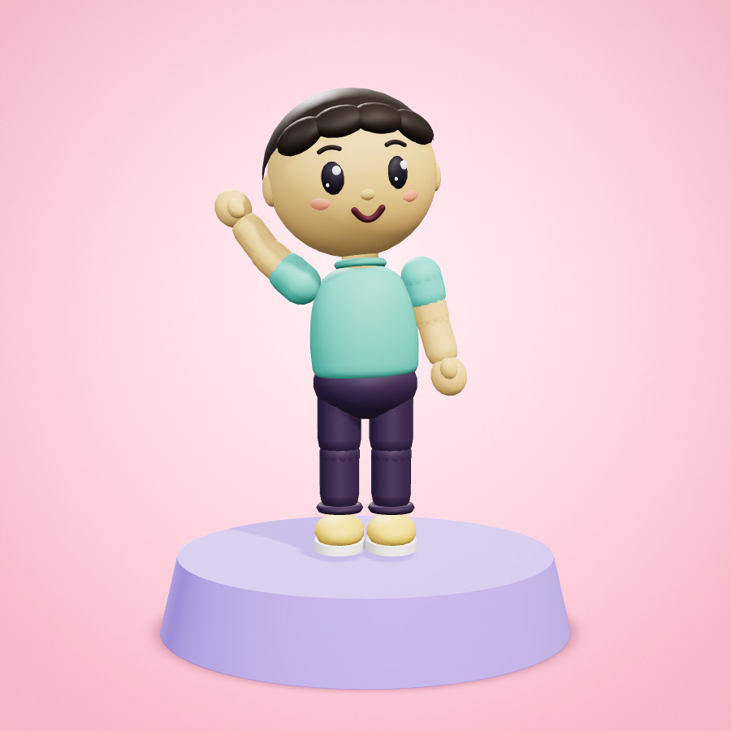 | 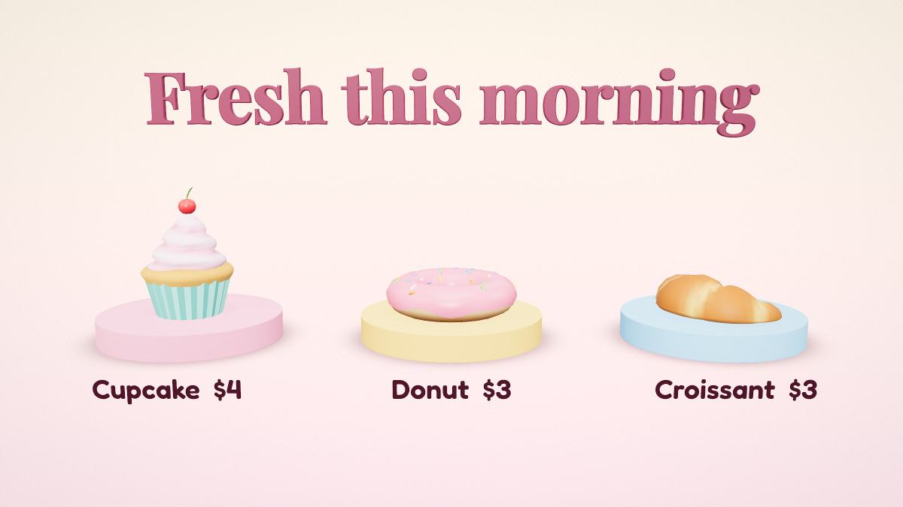 |
| Product packshot: softbox rig, contact shadow, drag to orbit | Character card: procedural mascot, eyes follow the pointer | Click-to-shop shelf: hover and link interactions |
| 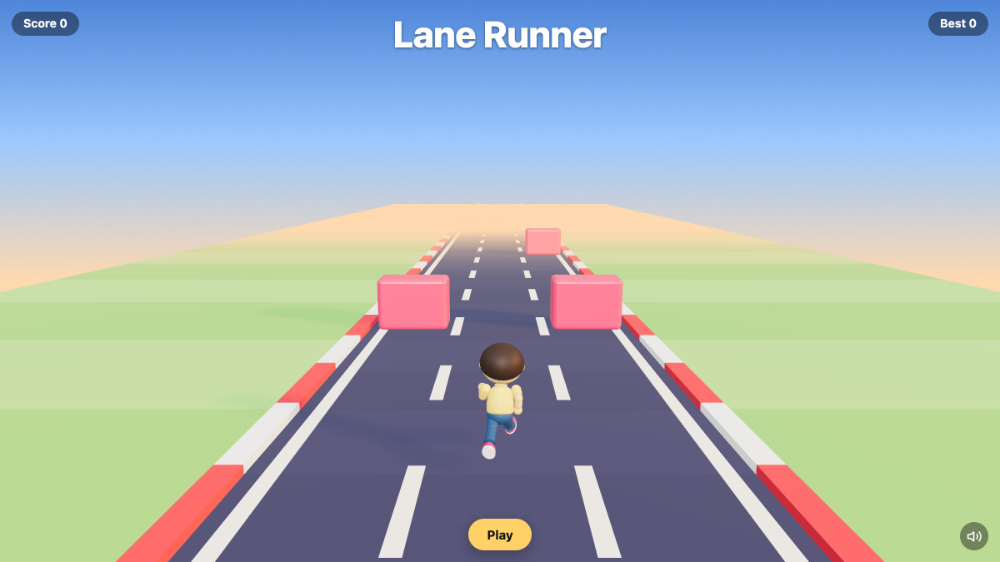 |  | 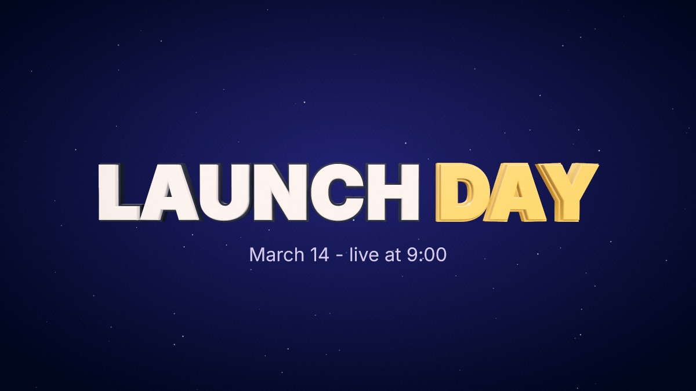 |
| Lane runner: a playable game with attract mode | Can toss: real rigid-body physics | Letter-by-letter headline reveal |

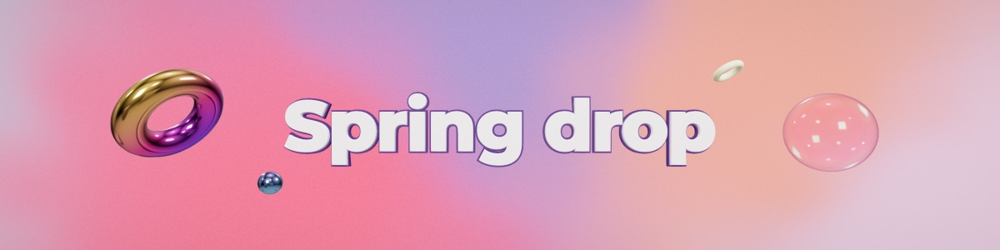

<sub>Headless renders of the validated [recipes](plugin/skills/agent3d-create/references/recipes.md), straight from `agent3d render`. Nothing was downloaded: everything is procedural or from the built-in library.</sub>

## What it makes

- **Banners, heroes and cards** — animated titles with 13 kerned fonts, outlines and letter-by-letter reveals, extruded SVG logos, product turntables, data-bound texts and links (`{data.title}`, filled per page with `data-*` attributes).
- **Characters and products** — a procedural character generator (humanoids, robots, animals, astronauts…, with animations and eyes that follow the pointer), ~130 built-in models (rigged characters with clips, photoreal products and props) and 38 material presets from car paint and ceramic to diamond and soap bubble.
- **Landscapes and dioramas** — 22 procedural generators: terrain (mountains, basins, valleys, islands, snow lines), forests, rocks, grass, flowers, water with foam and mirror reflections, clouds, flocks of birds, cities, floating islands, globes, galaxies, 3D bar charts — all zero bytes, deterministic from a seed.
- **Motion** — 29 behaviours (float, follow the pointer, tilt, hover lift, scroll parallax…), a keyframe timeline with every easing, springs, staggered multi-target tracks and perceptual (OKLCh) colour blends, cinematic camera shots, scroll-driven stories, hover / click / key interactions that play segments or open links — no code needed.
- **Mini games** — sandboxed scripts with keyboard, pointer and touch-swipe input, rigid-body physics (real shapes, joints, a character controller, moving platforms), spawning by cloning, a themable HUD, synth sounds, best scores, and an attract mode so the embed is alive before anyone plays.

## How agents drive it

1. **A scene is JSON** (`scene.json`): target and aspect ratio, camera, environment, lights, objects, materials, behaviours, timeline, interactions, post effects — and, for games, physics, a HUD and scripts. Everything is validated against one [catalog](docs/catalog.md) with "did you mean" hints, and edited with small atomic patches (`scene patch`) that show a plan before anything destructive.
2. **The agent looks at its work**: `render` drives your installed Chrome headless with a deterministic clock and returns frames and a contact sheet, triangle and draw-call counts and per-object framing. Games are *played* headlessly with simulated keys, taps, swipes and HUD clicks (`--input`), and the result comes back as the script's state.

   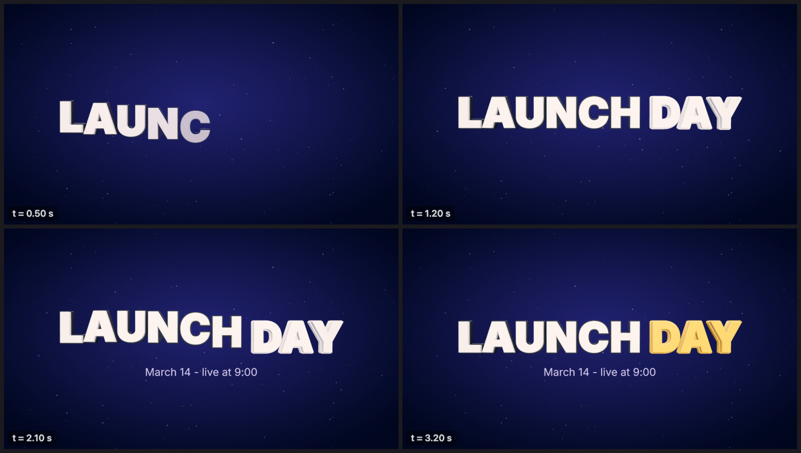

3. **`check`** catches what a reviewer would: validation, missing files, the script sandbox, triangles and draw calls **per frame across every pass** against the target's aim, KB budgets, framing, accessibility settings, licences that need credit.
4. **`export`** writes the embed and reports the real **page weight** (`pageKb` / gzip: the runtime chunks this scene loads plus its files), or a single HTML file, a poster, an MP4 / WebM video or a GIF.

```html
<script type="module" src="/agent3d/agent3d-runtime/agent3d-runtime.js"></script>
<agent3d-scene src="/agent3d/bakery/scene.json" poster="/agent3d/bakery/poster.webp" aria-label="Golden Crust Bakery: a warm 3D title with floating pastries"></agent3d-scene>
```

## Why the renders look good

- **Premium defaults per target**: one-line light rigs (softbox, studio three-point, golden hour, neon…), procedural studio reflections, physical skies with a matching sun, height fog, contact shadows, mesh-gradient backgrounds.
- **Physically based materials**: clearcoat, sheen, iridescence, transmission with real thickness, anisotropy, dispersion, procedural textures (marble, wood, terrazzo, carbon…) at zero bytes, cel shading that keeps brand colours true.
- **A finishing pass in one line**: `look` presets (cinematic, product, dreamy, neon, retro, clean) for bloom, ambient occlusion, grading, vignette and antialiasing; depth of field with rack focus, god rays, lens flare, tilt-shift and more.
- **Art direction built into the skills**: framing tables per aspect ratio, palettes, motion rules for web pages, and validated recipes the agent starts from — then it renders, looks, and fixes.

## Web-friendly by default

- Starts when it scrolls into view, pauses off-screen, caps the pixel ratio and adapts the quality tier to the device and frame rate.
- Respects `prefers-reduced-motion` (frozen on the poster frame), shows the poster without WebGL or JavaScript, reserves its aspect ratio (no layout shift), and carries an `aria-label`.
- The runtime loads in lazy chunks: a scene only downloads the features it uses. One runtime folder serves every scene of a site; Subresource Integrity, cache-busting and a documented Content-Security-Policy (no `unsafe-eval`).
- Drop-in for plain HTML, WordPress, Webflow, Shopify, AgentCMS ([plugin](integrations/agentcms/)), React / Next.js, Astro, Vue, Svelte — the export ships typed wrappers and an `EMBED.md` for the site owner.

## 30-second demo

```bash
npx -y @fleox/agent3d@0.2.0 new bakery --target banner --title "Golden Crust" --json
npx -y @fleox/agent3d@0.2.0 scene patch --project bakery --json '[{"op":"set","path":"objects#title.material","value":{"preset":"gold"}}]'
npx -y @fleox/agent3d@0.2.0 render --project bakery --sheet --json     # → renders/…-sheet.png
npx -y @fleox/agent3d@0.2.0 check --project bakery --json
npx -y @fleox/agent3d@0.2.0 export --project bakery --json             # → dist/embed/ + the snippet
```

Requirements: **Node.js 22+** and **Google Chrome** (or Chromium / Edge) for previews. `npx -y @fleox/agent3d@0.2.0 doctor` checks your setup. Step by step: [docs/getting-started.md](docs/getting-started.md).

## Use it from your agent

**Claude Code** — install the skills from this repository's plugin marketplace:

```text
/plugin marketplace add fleox/agent3d
/plugin install agent3d@agent3d
```

| Skill | Use it to |
|---|---|
| `agent3d-create` | Go from a brief to a finished embed: clarify, pick a template, build, render and look, fix, check, export — with art direction (composition, lighting, palettes, motion, budgets) and validated recipes per kind |
| `agent3d-edit` | Change an existing scene: patches, materials, lights, camera, timeline, interactions, behaviours, rebranding, phone checks |
| `agent3d-assets` | Built-in CC0 library, procedural generators, Poly Haven / ambientCG / Khronos downloads, Kenney / Quaternius packs, licences, `assets optimize` |
| `agent3d-game` | Mini games and interactive logic with the sandboxed ScriptApi (input, physics, spawning, HUD, sounds, best score, attract mode) and headless play-testing |
| `agent3d-publish` | Export formats, page weight, plain HTML and HTML text over the scene, WordPress, AgentCMS, React / Next.js / Astro / Vue / Svelte, accessibility and CSP |

**MCP** (Claude Desktop, Claude Code, Cursor, Hermes, any client) — the engine's tools plus `render_preview`, which returns the contact sheet as an **image** so multimodal models see their work:

```bash
claude mcp add agent3d -- npx -y @fleox/agent3d@0.2.0 mcp --project ~/agent3d/my-banner
```

Configuration for every client, and `--read-only`: [docs/mcp.md](docs/mcp.md).

**Hermes Agent** — the same skills with a stdlib-only Python wrapper and helpers: [hermes/](hermes/).

## The Studio

A visual editor for when you want to see and touch the scene yourself: a live viewport with move / rotate / scale gizmos, outliner, inspector, timeline, interactions, catalog and library browser, templates, checks, render and export dialogs, in English or French. Edits go through the same validated tools as the CLI, and changes your agent makes in a terminal appear live. An optional assistant uses your own Claude API key.

```bash
npx -y @fleox/agent3d@0.2.0 studio --project bakery
```

Details: [docs/studio.md](docs/studio.md). Live preview without the editor: `agent3d serve --project bakery --open`.

## Templates

31 starter projects, each a complete scene that passes `check --render` (`agent3d new my-scene --template <id>`; `agent3d templates list` filters by kind):

| Preview | Template | What it is |
|---|---|---|
| [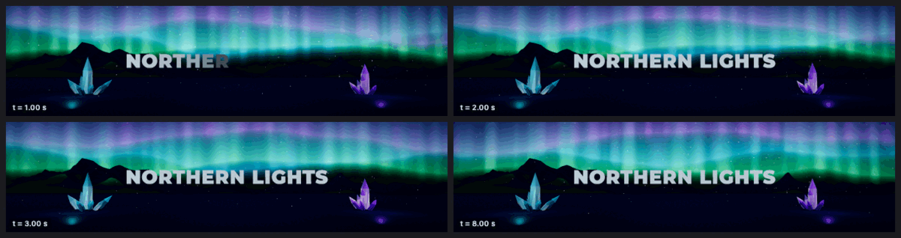](templates/banner-aurora-night/preview.png) | **Aurora night banner**<br>`banner-aurora-night` · banner | Night-sky 4:1 banner: animated northern-lights curtains over low-poly mountain silhouettes, twinkling stars, glowing cyan and violet crystal clusters in the snow and a white headline (data-bound) fading in letter by letter. |
| [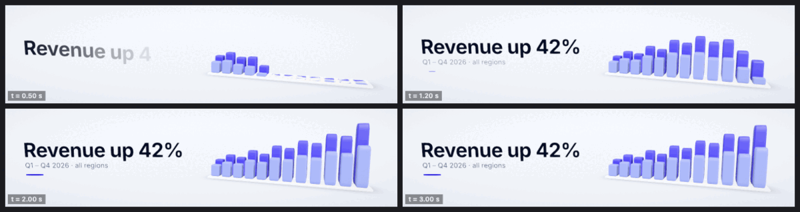](templates/banner-data-bars/preview.png) | **Data bars banner**<br>`banner-data-bars` · banner | Clean corporate 4:1 banner: a two-row 3D bar chart (your values) growing bar by bar in indigo on a white base plate, next to a data-bound headline and caption |
| [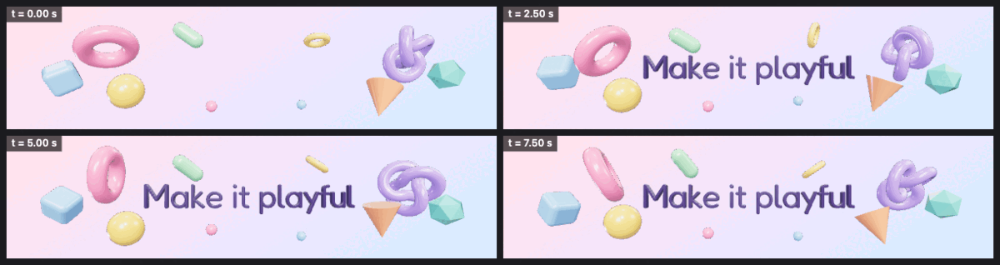](templates/banner-floating-shapes/preview.png) | **Floating shapes banner**<br>`banner-floating-shapes` · banner | Pastel 4:1 banner: a rounded 3D headline (data-bound) popping in letter by letter, framed by jelly, pearl, matte-pastel and gold shapes that spring in, float and shift with the pointer in depth layers over a drifting mesh-gradient backdrop. |
| [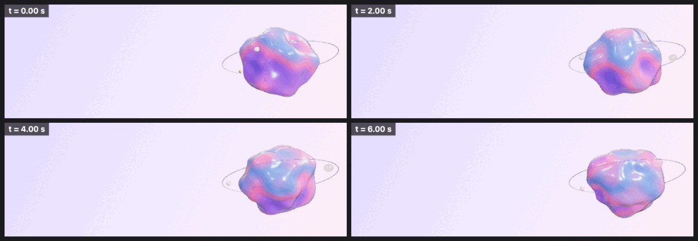](templates/banner-gradient-blob/preview.png) | **Gradient blob banner**<br>`banner-gradient-blob` · banner | Minimal 3:1 banner for SaaS / product pages: a glossy iridescent morphing blob in brand colours with a small companion blob, a thin chrome orbit with beads and a drifting pastel mesh-gradient backdrop; the left two thirds stay empty for your HTML headline. |
| [](templates/banner-liquid-chrome/preview.png) | **Liquid chrome banner**<br>`banner-liquid-chrome` · banner | Abstract 4:1 banner: a flowing liquid-chrome backdrop softly out of focus, morphing holographic and chrome blobs, and a bold kerned title (data-bound) revealed letter by letter from the centre, with cinematic grading and grain. |
| [](templates/banner-logo-extrude/preview.png) | **Extruded logo banner**<br>`banner-logo-extrude` · banner | Brand 4:1 banner: your SVG logo extruded into clear-coated 3D (keeping its colours) inside a neon halo, a wordmark revealed letter by letter and a tagline (both data-bound), a light sweep across the logo; it tilts toward the pointer, spins on hover and bounces on click. |
| [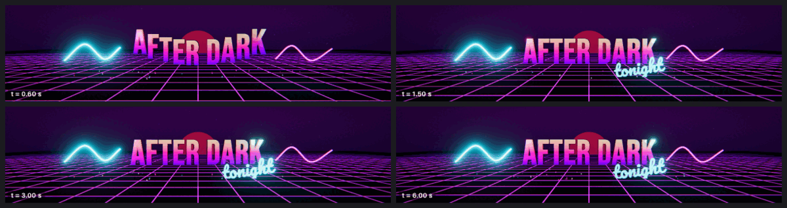](templates/banner-neon-title/preview.png) | **Neon title banner**<br>`banner-neon-title` · banner | Synthwave 4:1 banner: a tall condensed sunset-gradient 3D headline that drops in letter by letter from the centre, a flickering neon script tagline, neon tubes, a scrolling neon grid floor, a gradient sun, sparks and bloom (data-bound texts). |
| [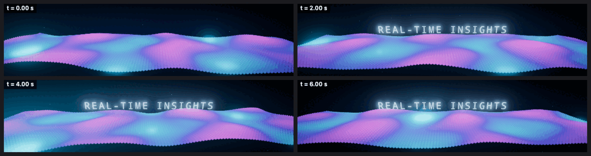](templates/banner-wave-grid/preview.png) | **Wave grid banner**<br>`banner-wave-grid` · banner | Dark tech / data 4:1 banner: a field of ~8,000 dots in a cyan-indigo-pink ramp undulating like a signal and rippling under the pointer, beneath a crisp Space Grotesk headline revealed letter by letter and a blinking mono kicker (data-bound). |
| [](templates/character-mascot-hero/preview.png) | **Mascot hero**<br>`character-mascot-hero` · hero | Friendly brand-mascot hero (16:9): a procedural fox waving on a pastel pedestal with a 3D speech bubble (text from scene.data), its head and eyes following the pointer; click or tap it and it jumps into a celebration with confetti and a new line, then settles back. Left half free for an HTML headline. Swap the style for an astronaut, robot, cat, bird, blob or ghost. |
| [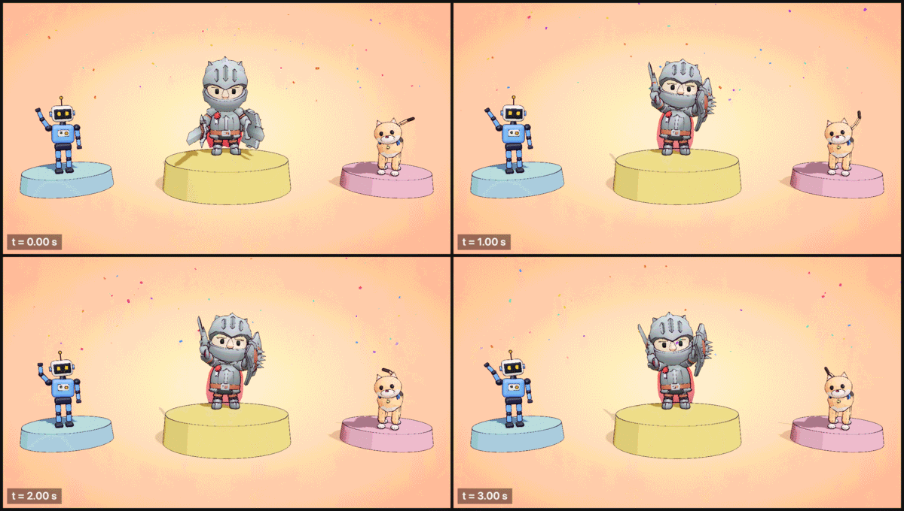](templates/character-showcase/preview.png) | **Character showcase**<br>`character-showcase` · hero | Cartoon character line-up (16:9) for mascots, kids' products, games or team pages: five procedural characters on pastel pedestals |
| [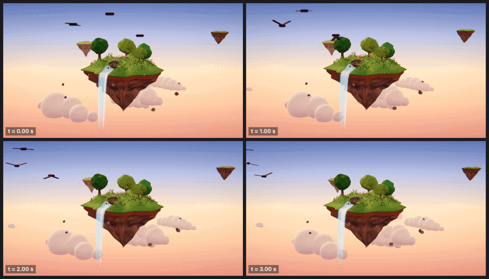](templates/hero-floating-island/preview.png) | **Floating island hero**<br>`hero-floating-island` · hero | Dreamy 16:9 hero: a low-poly floating island with trees, flowers, a pond and a waterfall pouring into a sea of pastel clouds, two distant islets, flapping birds circling and magic glints, under a peach-to-blue sunset gradient |
| [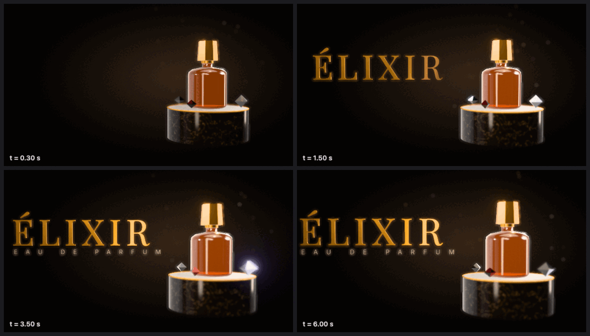](templates/hero-perfume-luxury/preview.png) | **Luxury perfume hero**<br>`hero-perfume-luxury` · hero | Dark luxury product hero: an amber glass perfume bottle (refractive lathe glass with liquid colour) and faceted gold cap on a black-and-gold marble pedestal, diamonds and a ruby catching the light, a slow push-in with a rack focus from a diamond to the bottle, and a gold serif name (data-bound). |
| [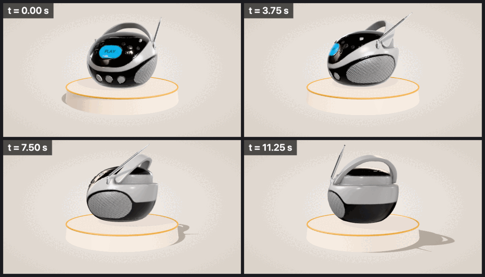](templates/hero-product-turntable/preview.png) | **Product turntable hero**<br>`hero-product-turntable` · hero | Studio product hero: a realistic PBR boombox slowly turning on a terrazzo pedestal with a gold rim, softbox light rig, studio HDRI reflections, soft contact shadow, product look and drag-to-orbit. |
| [](templates/hero-saas-globe/preview.png) | **SaaS globe hero**<br>`hero-saas-globe` · hero | Dark premium SaaS / network hero: a dotted-continent globe with a blue atmosphere slowly turning on the right, glowing arcs with light pulses travelling between world cities, faint orbit ring and stars; the left half stays empty for your HTML headline. |
| [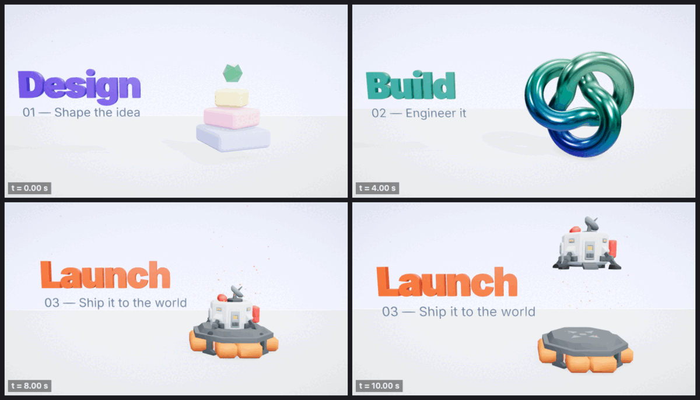](templates/hero-scroll-story/preview.png) | **Scroll story hero**<br>`hero-scroll-story` · hero | Scroll-driven 3D story: as the page scrolls, the camera glides across three chapters |
| [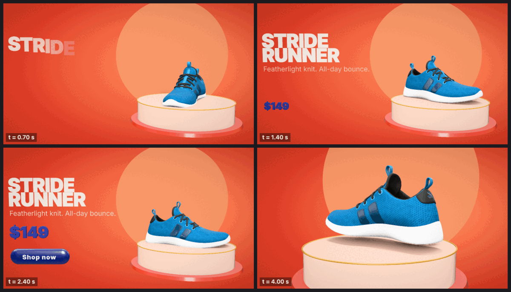](templates/hero-sneaker-showcase/preview.png) | **Sneaker showcase hero**<br>`hero-sneaker-showcase` · hero | E-commerce product hero: a real PBR sneaker spins onto a ceramic pedestal on a bold coral backdrop, with a data-bound title, tagline, price and Shop now button; click the shoe to glide the camera to a detail view. |
| [](templates/hero-space-planet/preview.png) | **Space planet hero**<br>`hero-space-planet` · hero | Cinematic 21:9 space hero: a ringed low-poly planet side-lit into a crescent, an orbiting moon, a drifting purple-blue nebula backdrop, twinkling stars, nebula dust and a comet, bloom + lens flare + film grade, drifting with the pointer |
| [](templates/landscape-island/preview.png) | **Tropical low-poly island**<br>`landscape-island` · hero | Sunny 16:9 procedural diorama: a tropical low-poly island (palm-lined beaches, round-canopy forest, rocky summit) in turquoise lagoon water with animated shore foam, puffy clouds and seabirds circling, cinematic grade, slow orbit + drag. Zero downloads. Behind a headline: set camera.autoRotate to 0 and shift camera.target (see README). |
| [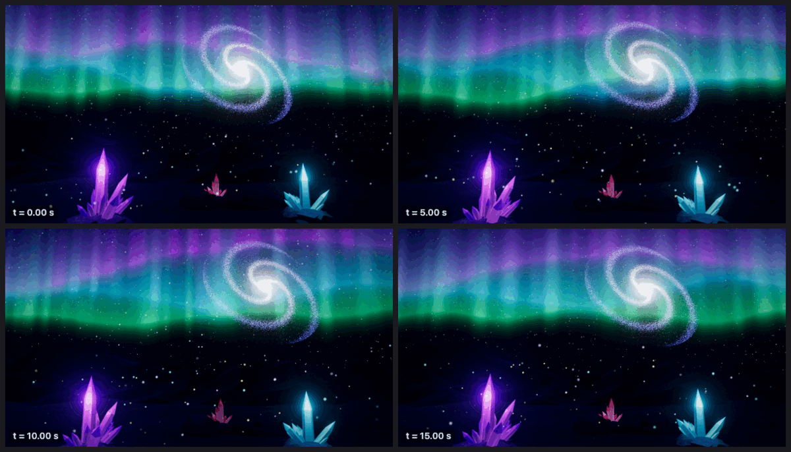](templates/landscape-night-galaxy/preview.png) | **Night galaxy landscape**<br>`landscape-night-galaxy` · hero | Calm 16:9 night hero: glowing crystal clusters (purple, cyan, pink) on dark low-poly hills under a vast rotating spiral galaxy, northern-lights aurora curtains, twinkling stars and drifting fireflies, bloom and a cool grade, slow 20 s camera drift + pointer parallax. Fantasy, AI, web3, gaming or meditation landings. Zero downloads. |
| [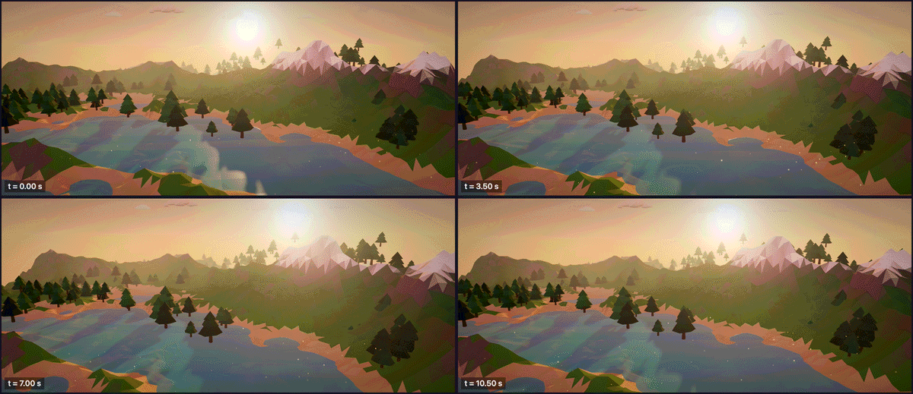](templates/landscape-valley-sunset/preview.png) | **Mountain valley at sunset**<br>`landscape-valley-sunset` · hero | Atmospheric 21:9 landscape: a low-poly mountain valley closed by a snowy range, a pine forest and an animated lake under a physical golden-hour sky, the sun low at the edge of the frame with soft god rays, valley height fog, pink clouds and fireflies |
| [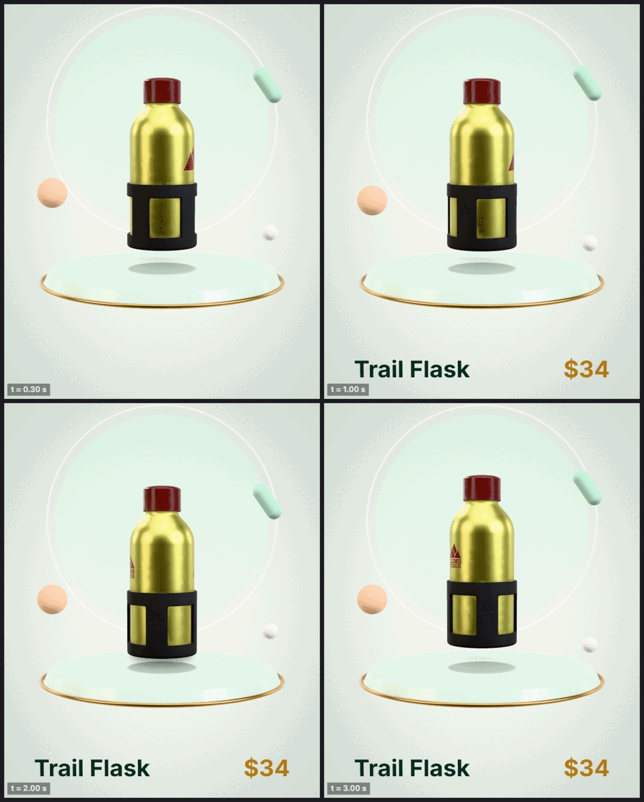](templates/card-hover-3d/preview.png) | **3D product card**<br>`card-hover-3d` · card | Clean product card (4:5): a PBR water bottle turning over a glossy sage disc with a soft contact shadow, softbox lighting and product look; it lifts, tilts toward the pointer and grows on hover, with a data-bound name, price and link |
| [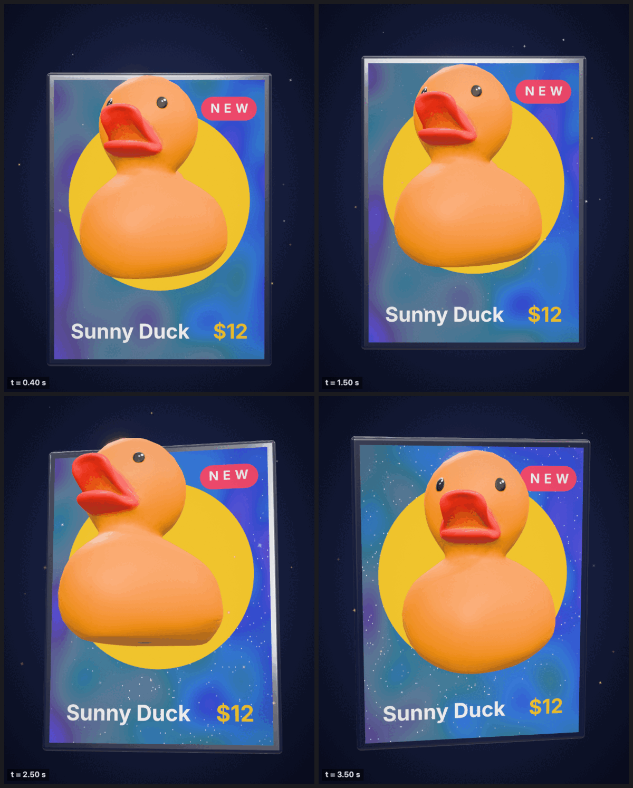](templates/card-product-tilt/preview.png) | **Product tilt card**<br>`card-product-tilt` · card | Collectible-style product card (4:5): a glossy PBR rubber duck pops out of a holographic-foil card with a sun disc, tilting toward the pointer with a shifting rainbow glare; data-bound name, price, badge and link |
| [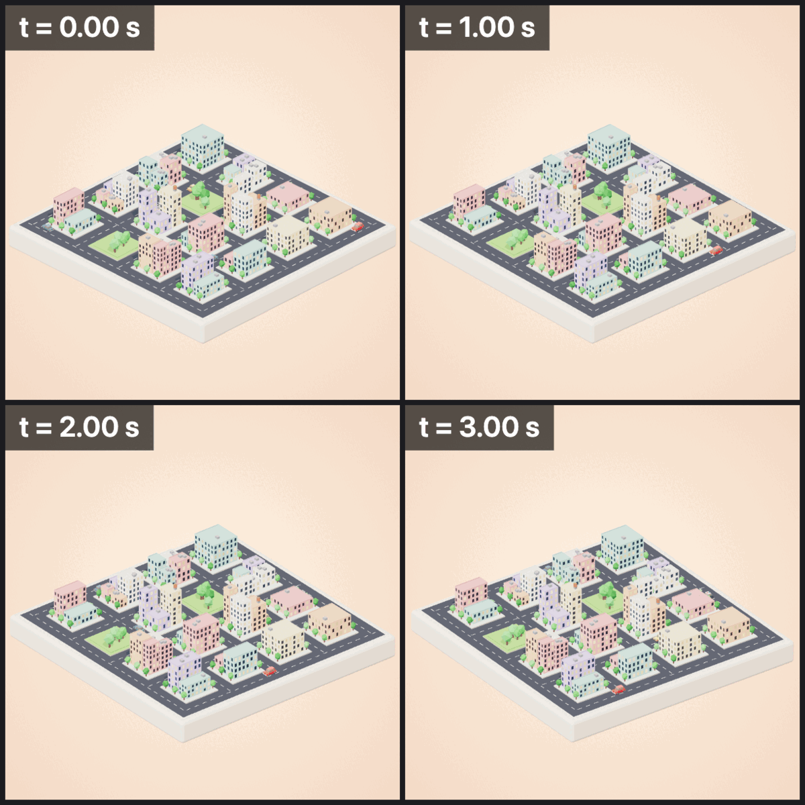](templates/diorama-city/preview.png) | **Isometric city diorama**<br>`diorama-city` · square | A Townscaper-like isometric city block (1:1): pastel procedural buildings with lit windows, a park and street trees on a floating clay slab, library cars, a taxi and a police car driving the streets, low warm sun with long soft shadows, tilt-shift miniature blur and a cinematic grade, slow orbit. |
| [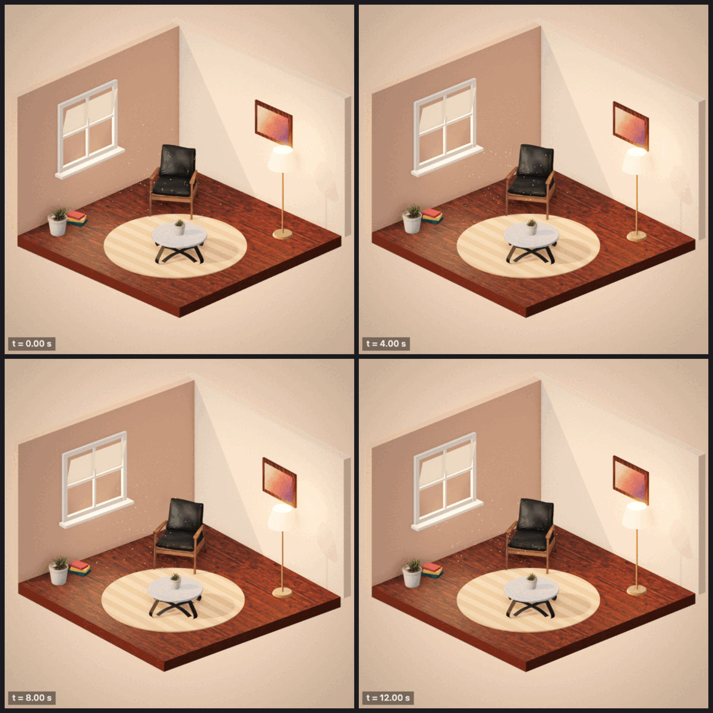](templates/scene-cozy-room/preview.png) | **Cozy room diorama**<br>`scene-cozy-room` · square | Isometric cozy living-room corner (1:1) at golden hour: photoreal Poly Haven props (modern armchair, round coffee table, potted succulents) on a wooden floor with a striped rug, a glowing floor lamp, a window area light with dust drifting in the light, framed art, soft VSM shadows, cinematic warm grade and a slow camera sway. Interior design, real estate, furniture, lifestyle or 'work from home' pages. |
| [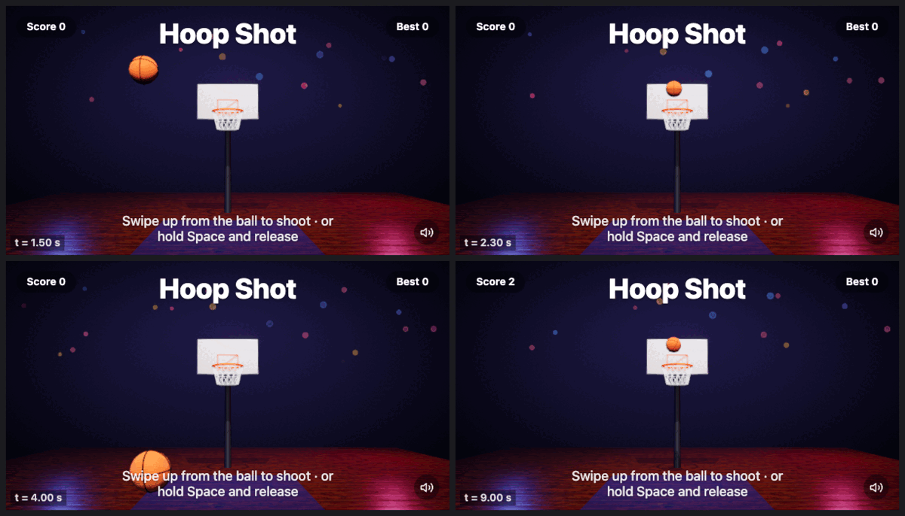](templates/game-basket/preview.png) | **Hoop shot**<br>`game-basket` · game | Playable 45-second basketball shooting game (16:9) on real rigid-body physics: swipe or drag up to shoot (length = power, drift = aim) or hold Space to charge and release, the ball bounces off a trimesh rim and the backboard, swishes count only when falling through the net, a new spot after every shot, x2 / x3 streaks, best score saved, impact sounds, confetti, spotlit night arena, self-playing attract mode. |
| [](templates/game-coin-collector/preview.png) | **Coin collector arena**<br>`game-coin-collector` · game | Playable 3D platformer arena (16:9): run and jump across a floating grass island and stepped platforms above a sea of clouds to collect 12 coins before the 45 s timer ends |
| [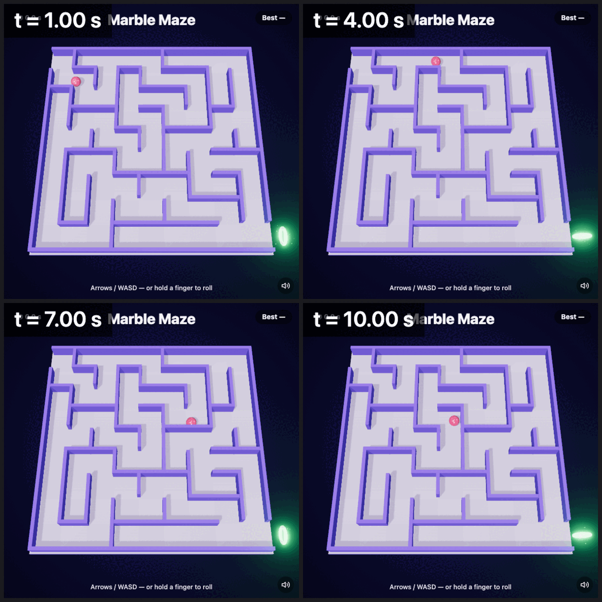](templates/game-maze/preview.png) | **Marble maze**<br>`game-maze` · game | Playable marble maze: roll a glossy ball through a procedural maze to the glowing exit against the clock |
| [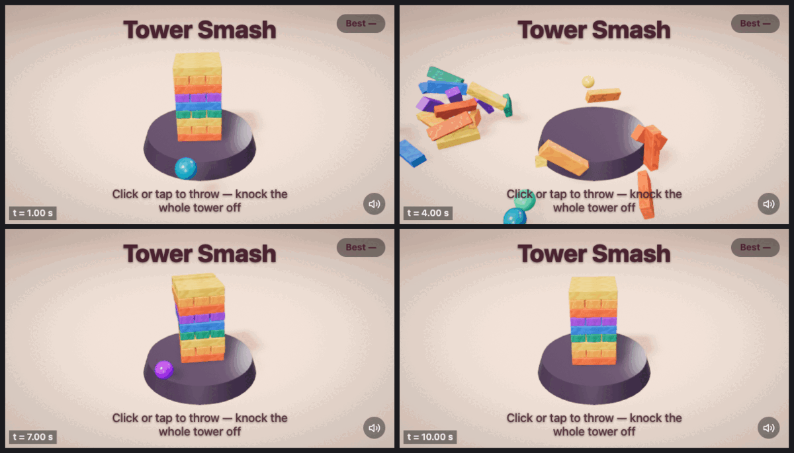](templates/game-physics-playground/preview.png) | **Tower smash (physics)**<br>`game-physics-playground` · game | Rigid-body physics playground: click or tap to throw balls at a tower of wooden blocks that really tumbles, slides and stacks |
| [](templates/game-platformer/preview.png) | **Sky platformer**<br>`game-platformer` · game | Playable side-scrolling platformer (16:9): a rigged KayKit knight runs and jumps (physics character controller with coyote time) across floating grass platforms, a sliding lift and an elevator lift, collects 13 coins and reaches the goal flag against a 90 s timer |
| [](templates/game-runner/preview.png) | **Endless runner**<br>`game-runner` · game | Playable endless runner: switch lanes and jump over barriers on a scrolling road, grab coins, speed ramps up, best score saved, game over + retry, synth sounds, keyboard + touch, self-playing attract mode. |
| [](templates/game-tap-targets/preview.png) | **Tap the targets**<br>`game-tap-targets` · game | Playable 30-second reflex game: targets pop out of nine holes, tap or click them, chain hits for a combo multiplier, golden targets score 5× |

## What you get in an export

```
dist/embed/
  agent3d-runtime/        the player (ES module + lazy chunks), shared by every scene of the site
  bakery/                 scene.json, assets/, scripts/, poster.webp, og-image.png, CREDITS.txt
  index.html              a demo page with the snippet and the credits
  snippet.html, head.html what to paste into your page (and its <head>)
  EMBED.md, frameworks/   instructions for the site owner, React / Vue / Svelte wrappers
```

Also: `--format zip`, `single-html` (one file with everything inline), `poster` (a still), `video` (MP4 / WebM) and `gif`. Details: [docs/export.md](docs/export.md) and the `agent3d-publish` skill.

## Privacy and the network

The runtime, the CLI, the Studio and the exports never call a third-party service. The only network use is the optional `assets search` / `assets add` against free, account-less CC0 sources (Poly Haven, ambientCG, Kenney, Quaternius, Khronos samples): files are downloaded **once into your project** with their licence recorded in `assets/manifest.json`, and exports never hotlink. Game scripts run in a sandbox with no network, DOM or storage access beyond their own API. Details: [docs/security.md](docs/security.md).

## Documentation

[docs/](docs/README.md): [scene format](docs/scene-format.md) · [art direction](docs/art-direction.md) · [catalog](docs/catalog.md) · [CLI](docs/cli.md) · [MCP](docs/mcp.md) · [scripting](docs/scripting.md) · [export](docs/export.md) · [assets](docs/assets.md) · [Studio](docs/studio.md) · [architecture](docs/architecture.md) · [security](docs/security.md) · [releasing](docs/releasing.md). Contributors and agents working on this repository: [AGENTS.md](AGENTS.md) and [CLAUDE.md](CLAUDE.md). Release notes: [changelog.json](changelog.json).

## Licence

[PolyForm Noncommercial 1.0.0](LICENSE) — free for personal, research, educational and other noncommercial use. Contact the author for commercial use.

## Credits

- [three.js](https://threejs.org) (MIT) renders everything; [cannon-es](https://github.com/pmndrs/cannon-es) (MIT) runs the physics; [meshoptimizer](https://github.com/zeux/meshoptimizer) (MIT) decodes compressed models.
- The built-in library is CC0 (KayKit by Kay Lousberg, Kenney, Poly Haven textures, models and HDRIs, Khronos glTF samples, RobotExpressive by Tomás Laulhé / Quaternius), with the fonts under Apache-2.0 / OFL-1.1 and CC BY parts on the Khronos fox: full list and attribution lines in [library/LICENSES.md](library/LICENSES.md). Exports list the credits their assets need.
- Assets you download with `agent3d assets` keep their licence in your project (`assets/manifest.json`).
