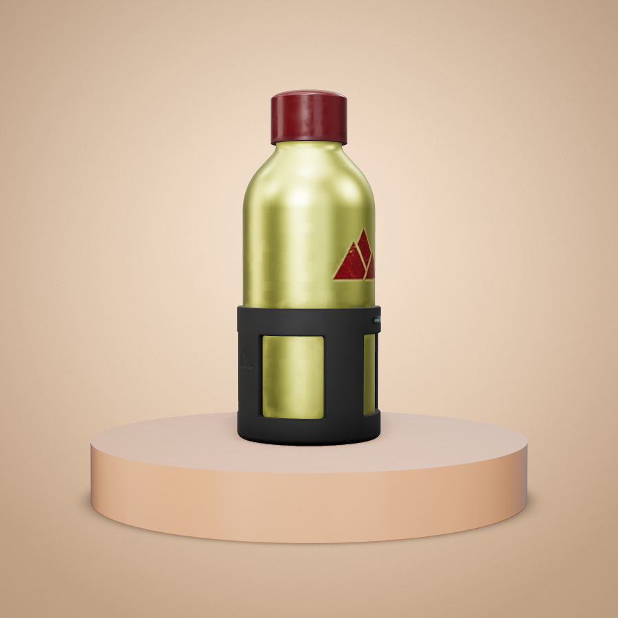
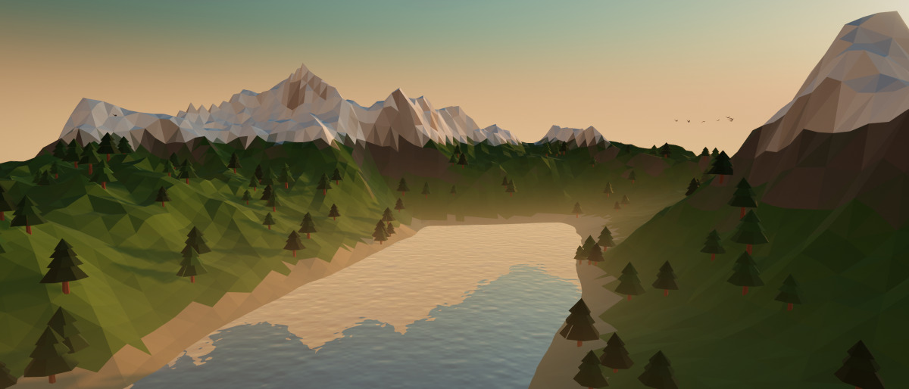
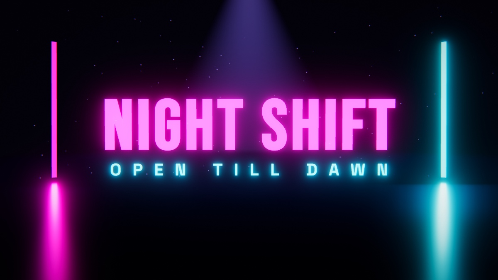
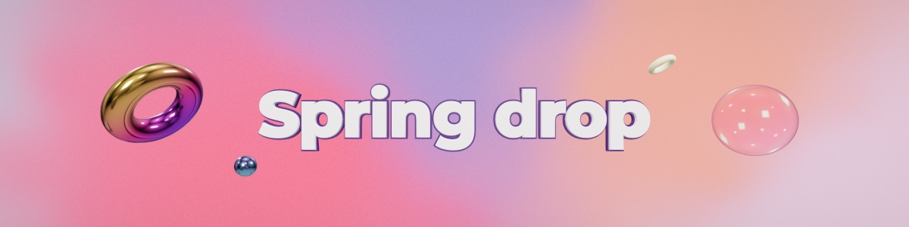
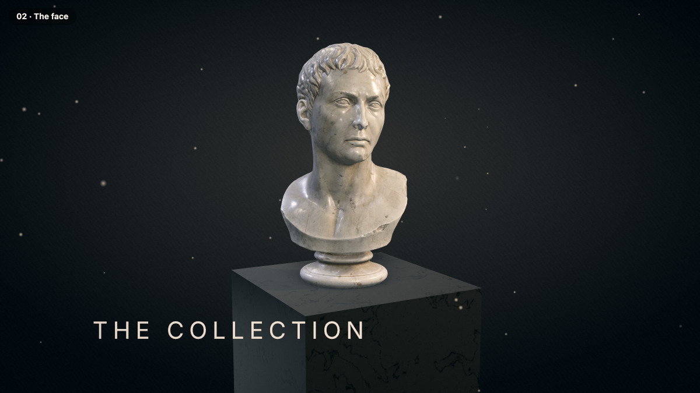
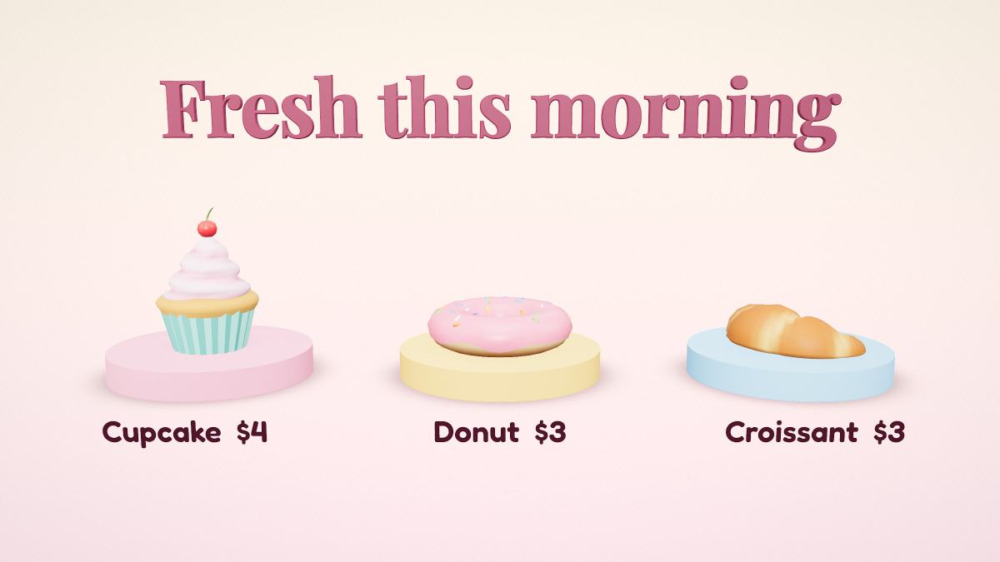
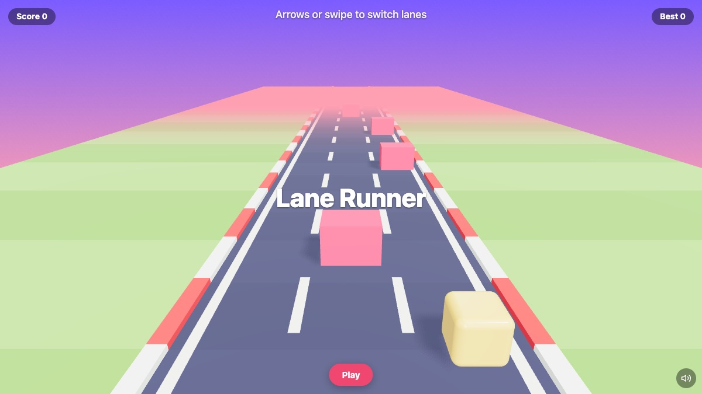
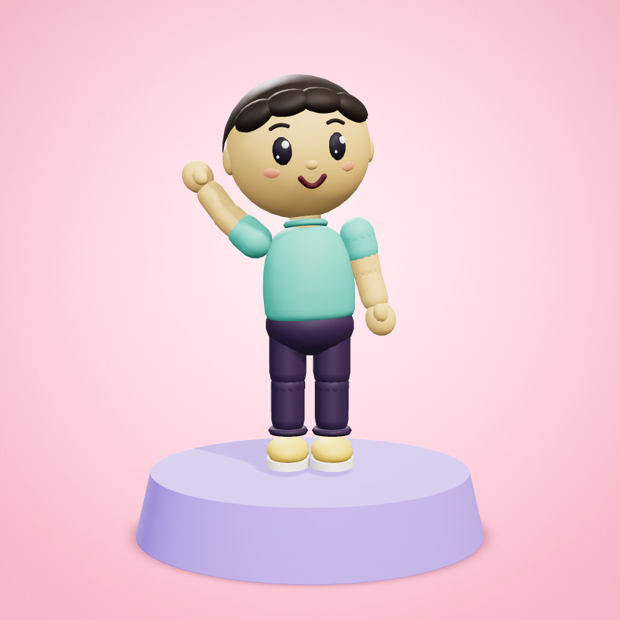
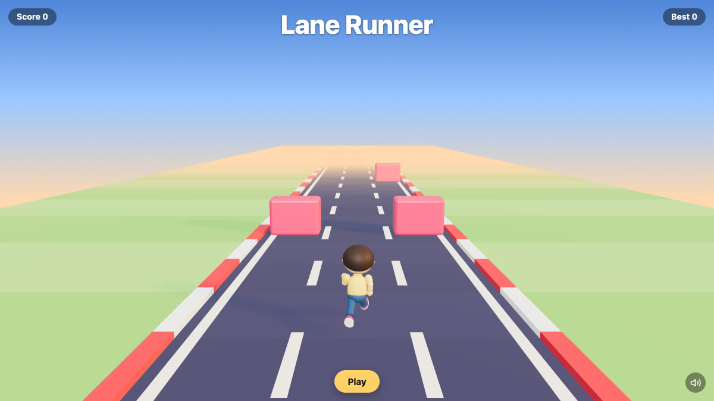

# Art direction: premium defaults

How to make an Agent3D scene look good on the first render. Each row below is a starting point your agent (or you) can take as is; the full scenes are the recipes in [`plugin/skills/agent3d-create/references/recipes.md`](../plugin/skills/agent3d-create/references/recipes.md), and the images are real headless renders of them.

| | | |
|---|---|---|
|  **Product shot** |  **Golden-hour landscape** |  **Neon title** |
|  **Mesh gradient banner** |  **Letter-reveal headline** |  **Scroll story** |
|  **Click-to-shop shelf** |  **Physics toss game** |  **Character card** |
|  **Lane runner game** | | |

## Where to start, per kind

| Kind | Background and environment | Light rig | Post-processing | Quality |
|---|---|---|---|---|
| **Banner** (4:1) | Mesh gradient or a 2–3 tone gradient, studio reflections | `studio-3point` | `clean` look; no bloom on light backgrounds | `auto` |
| **Hero** (16:9) | Radial gradient centred on the subject | `studio-3point`, `dramatic` (moody) or `neon` (night) | `cinematic` look at 0.6–0.8, `neon` at 0.7 | `auto` |
| **Product / card** | Light radial gradient in the product's tones, studio reflections (or the softbox HDRI, +1.5 MB) | `softbox`, `product-top` for glossy and metal | `product` look | `auto` |
| **Landscape** (21:9) | Physical sky preset (`golden-hour`, `afternoon`…) + height fog; the sky adds the sun | the sky's own sun | bloom + warm grading + vignette (or `cinematic` at 0.6–0.8 when the scene is light: its AO pass re-draws the geometry) | `auto` |
| **Character** | Soft radial gradient, soft reflections | `studio-3point` with a warm tint | `clean` look or none | `auto` |
| **Game** | Plain gradient or colour | `studio-3point` | none, or bloom / grading / vignette / FXAA only | `medium` |

Everything that stands on something gets **contact shadows** (soft, no shadow-casting light needed). Every scene gets an accessible label and a poster time where the composition is complete.

## What makes the difference

- **Rigs over hand-placed lights.** A rig (`environment.rig`) is a tuned set of lights for a subject near the origin; turn it with `rotation` to move the highlight, scale it with `intensity`.
- **Looks over effect stacks.** A look (`cinematic`, `product`, `dreamy`, `neon`, `retro`, `clean`) is a tested stack; override one parameter at a time next to it.
- **Keep the sun out of frame.** A low physical sun in view, with fog or bloom, washes the whole image out. Light from the side.
- **Watch bloom on bright surfaces.** Emissive neon text around 2–2.6 glows; above ~3 the frame turns into fog. White text on a light background glows too.
- **No pure white under a softbox.** Use a tone of the background for pedestals and tables.
- **Light text on light backgrounds needs an outline.**
- **Re-render after every change** and look at the contact sheet: framing, cut text and empty first frames are only visible there.

## Mobile and games

- Ambient occlusion and depth of field are high-cost effects; god rays and lens flares are medium. The `cinematic` and `product` looks include ambient occlusion: great on a hero still, not in a game. `agent3d check` reports the per-frame cost (`budget.gpu`) and warns about heavy effects on games.
- Avoid volumetric lights, many shadow-casting lights, large transparent glass and big HDRI files in small embeds (the built-in `studio`, `soft`, `sunset` and `night` lighting are free).
- `target.quality: "medium"` for games and busy fullscreen scenes; `auto` already steps down on phones and when the frame rate drops.
- A 4:1 banner is about 95 px tall on a phone: keep titles big, or export a taller version for mobile.

Exact parameters for every rig, look, material, shader and generator: `npx -y @fleox/agent3d@0.5.2 catalog <section> [id] --json` or [catalog.md](catalog.md).
